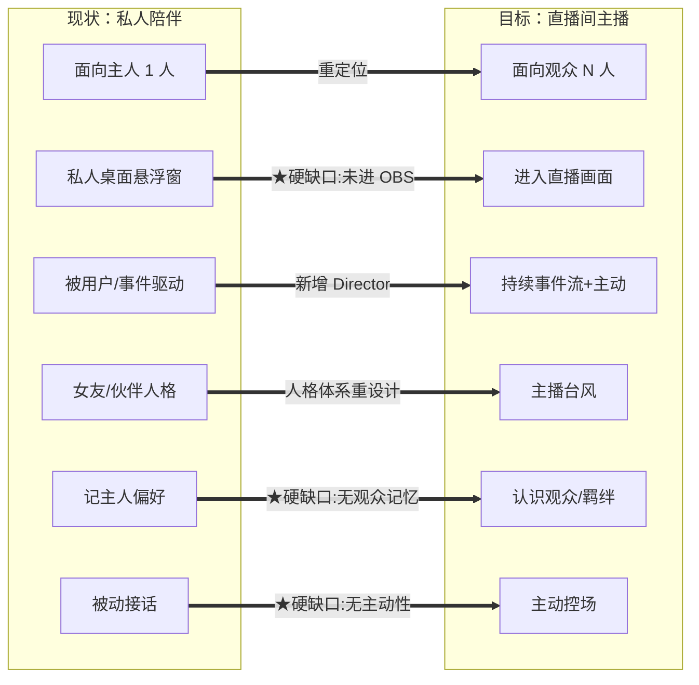
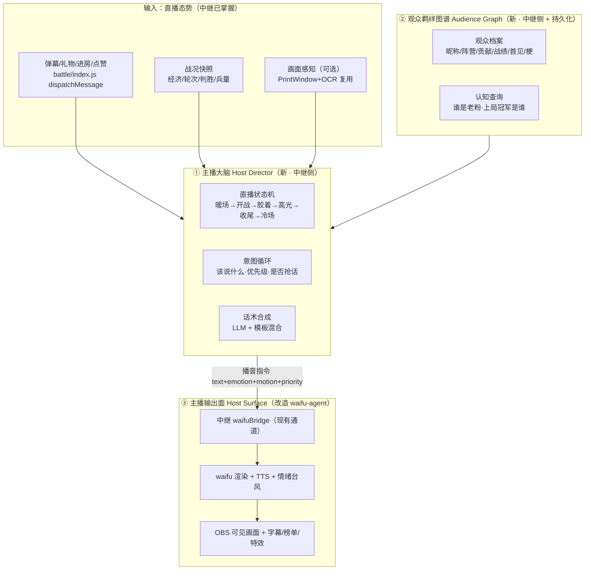

> **Model: deepseek-flash (cheap)**

> **Status: APPROVED** — 2026-09-27T10:14:55.935Z

# waifu-agent 主播化重设计：从「桌面陪伴」到「直播间主播」

> 本计划面向 zero-context 执行者。所有锚点为 `文件:行`，2026 取证。
> 涉及两个子仓库（`waifu-agent` 与 `danmaku-relay`）——**它们各自独立 git**；顶层仓库只管 docs。
> ⚠️ 改 `danmaku-relay/battle/*.js` 后**必须重启中继**才生效（只在启动时 require，见 `docs/项目工作流.md` §5）。

## 需求提炼

**用户原话（逐字）**
> 「当前 waifu-agent 现在包括之前其实都是按照个人陪伴来设计的，而当下项目更多的是要求的是能够完全充当这个项目的主播角色，所以相关涉及的都需要为这个开路为这个进行适配或重设计，给出你的计划，我希望听到创新性的实际性的」

**提炼成三条可验收目标**

1. **重定位**：waifu 从「面向主人（1 人）的私人陪伴桌宠」变成「面向直播间观众（N 人）的 AI 主播」——观众**看得到**、**持续在岗**、**有台风**的主持人。
2. **全线开路**：与「主播」职能相关的每一环（**可见性 / 驱动 / 人格 / 记忆 / 表现 / 主动性**）都要为这个角色改造或重设计，不是只改一句 prompt。
3. **交付形态**：既要**创新性**（不是把「女友」二字替换成「主播」），又要**实际性**（最大化复用现有资产、分波落地、每波可验证）。

**非目标（本计划不做）**

- 不改抖音/B站适配器链路、不重做注入 jar、不换游戏（`README.md` 整合说明 + `.rivet/HANDOFF.md` 非目标）。
- **不删除**现有「陪伴」能力——保留为「主播本人（操作者）的私有模式」，双形态共存。
- 本计划内不做「多主播同台 / AI 对手导师」（列为 Wave 5 之后的可选后续）。
- 不动 `war-danmaku`（历史模块，已不在链路，见 `README.md` 脚注）。

---

## 一、现状诊断：产品原点错位

waifu-agent 的一句话定位（`waifu-agent/README.md`、`waifu-agent/CLAUDE.md`）是 **「不是会聊天的桌宠，是给 Agent 一张脸」**。它的全套设计是**私人的、一对一的、被动的**：

| 证据 | 原文锚点 | 说的是什么 |
|---|---|---|
| 人格面向「主人」 | `waifu-agent/SOUL.md`：「你是住在**主人**电脑桌面上的 Live2D 角色……你是个有自己态度的**桌边伙伴**」 | 单人、私密关系 |
| 记忆面向「主人」 | `waifu-agent/MEMORY_RULES.md`：「只有当**主人**明确说"记住"……」 | 记的是主人的个人偏好 |
| 中继侧人格是「女友」 | `danmaku-relay/battle/waifuChat.js` `PERSONA`：「你是抖音直播间《红蓝对战》的 AI 虚拟主播，名字「默川」。你是**主播的女朋友**，也是直播间的女主人」 | 个人陪伴的投射 |
| 预设人格 | `waifu-agent/src/souls/`（6 个）：`mao-girlfriend / mao-teasing / mao-warm / mao-cool / mao-energetic / mao-rebel` | 全是「伴侣/伙伴」谱系 |
| 商业模式 | `waifu-agent/docs/项目规划/项目概览.md`（爱发电激活码 + free/pro 分级） | 卖给**个人用户**，不是直播运营 |

而「项目主播」需要的是**公开的、一对多的、主动的、有台风的**主持人。这是一个**产品原点的错位**——不是参数没调好，是设计目标不同。

### 六个维度的缺口（诊断框架）

| # | 维度 | 现状 | 目标 | 缺口性质 |
|---|---|---|---|---|
| 1 | 受众 | 主人（1 人，私密） | 观众（N 人，公开） | 人格/知识重定位 |
| 2 | **可见性** | 私人桌面悬浮窗（600×800 透明无框，`persona.config.ts`） | **在直播推流画面里** | ★**未进入 OBS** |
| 3 | 驱动 | 用户输入 / 中继事件 | 持续事件流 + 主播主动 | ★**无主动调度** |
| 4 | 人格 | 女友/桌边伙伴 | 主播台风（口头禅/节奏/标签） | 人格体系重设计 |
| 5 | **记忆** | 主人的偏好（`MEMORY_RULES.md`） | 观众名册 + 羁绊 + 战绩 | ★**无观众记忆（且不持久）** |
| 6 | 表现/主动性 | 被动播报（几乎全 `emotion:'happy'`） | 主动控场 + 情绪台风 + 下场制造互动 | 表现层升级 |

**最难、也是「主播」之所以为主播的两个硬缺口**：
- **可见性**：waifu 现在**不在直播画面里**（详见「反证/复现」）。观众根本没看见它——它只是主播自己屏幕上的一只桌宠。
- **主动性**：waifu 现在**只在事件发生时被念一句**（`waifuAnnouncer` 四个 announce* + `index.js:471` maybeChat，全部事件触发，**无一处定时/主动**）。主播的核心是「持续在场、会自己找话、会控节奏」。

---

## 二、目标架构：主播三件套

核心思路——**不推倒重来，把 waifu 从「渲染壳 + 被动播报」升级为「主播」**，新增两个中继侧子系统 + 改造一条输出面：

### ① 主播大脑 Host Director（新，中继侧）
新增 `danmaku-relay/battle/waifuDirector.js`。它是**从「事件反射器」到「有剧本意识的导演」**的关键：
- **直播状态机**：`WARMUP`（暖场）→ `ROUND_START` → `FIGHTING` → `CLIMAX`（高光/胶着）→ `ENDING` → `COLD`（冷场）。状态由战况事件 + 静默时长驱动。
- **意图循环**：定时 tick + 事件驱动两条腿。冷场 → 主动找话题（回顾上轮高光、念榜单、提问）；高光 → 主动拉情绪。
- **优先级与抢话**：播音指令带 `priority`，高优先级可打断低优先级（现 `waifuBridge.speak` 是 fire-and-forget，**无优先级**——这是要补的）。
- **话术合成**：模板（快、稳）与 LLM（活、准）混合——高确定性场景（生兵/胜负）走模板，需要临场感（解说/接梗）走 LLM（复用 `waifuChat` 的 LLM 配置通道，`danmaku-relay/data/llm.json`）。

### ② 观众羁绊图谱 Audience Graph（新，中继侧 + 持久化）
新增 `danmaku-relay/battle/audience.js`，复用 `battle/leaderboard.js` 的累计口径：
- **档案**：pid → {昵称, 阵营, 召唤数, 花费, 点赞/关注, 战绩, 首见时刻, 最后出现, 自定义梗}。
- **认知查询**：`isRegular(pid)`（老粉）、`lastRoundChampion()`（上局冠军——已在 `index.js` 的 `lastChampions`），供主播说「张三你上局冠军，这局别拉胯」。
- **持久化**：落 `danmaku-relay/data/audience.json`（**新增文件**；`data/` 已 `.gitignore`）。现状 `battle/index.js` 的 `playerTeams`/`playerNames` 与 `leaderboard.js` **都只驻内存、重启即丢**（两处注释均为证）——这是「认识观众」的地基。

### ③ 主播输出面 Host Surface（改造 waifu-agent）
让 waifu **进入观众视野**：
- **可见性**（Wave 0 先验证路线）：OBS `window capture` 捕获 waifu 的 Tauri 透明窗口 **或** 新增 OBS `browser source` 渲染（复用现有 PIXI + Live2D 前端）。路线由 Wave 0 实机探针裁定。
- **表现层**：字幕（念稿可视化）、榜单/战报叠加（复用 `danmaku-relay/toolbox/leaderboard.html` 的模式）、情绪台风（战况驱动的表情/动作）。
- **直播态渲染**：与现有「桌面态」并存（双形态）——桌面态面向主播本人，直播态面向观众。

---

## 三、创新点（不是改 prompt）

1. **从「事件反射」到「有剧本意识的导演」**——维护直播状态、主动找话、控节奏（Director 状态机）。
2. **从「主人的记忆」到「认得每个观众」**——持久化观众羁绊图谱，主播能点名老粉、记得战绩。
3. **让主播「看得见」战场**——复用项目已有的 `capture_game_frame.py`（PrintWindow+OCR，`docs/项目工作流.md` §8 已登记）给主播装眼睛，实现真解说（「红方经济见底了」）。
4. **主播的「情绪台风」**——情绪是战况的函数（领先兴奋/胶着紧张/逆袭爆发/落败自嘲），不是恒定 `happy`。
5. **主播「下场」制造互动**——发起投票/预言/挑战/悬念，把观众从「看」变成「玩」。
6. **变现即主持内容**——冠名口播、礼物专属动作、关注解锁，不打断直播，本身就是节目。

---

## 四、分波实施

> 每波结束判据 = 该波验证命令 exit 0 / 实机项有截图或日志证据。**未跑 = 未验证**。

### Wave 0 — 地基探针（先验证三个前置假设，别在错误前提上盖楼）

> 结束判据：三条探针各出一份「是/否 + 证据」（日志/截图/代码引用）。**任何一条为否，对应下游波次改路线。**

- **探针 0.1（可见性路线）**：OBS 能否捕获 waifu 的 Tauri 透明窗口？→ 实机：起 waifu，在 OBS 加 `窗口捕获` 指向 `waifu-agent.exe` 窗口，看是否收到透明背景下的角色。记录结论 → 决定 Wave 3 走 `window capture` 还是 `browser source`。
- **探针 0.2（通道能力）**：现 `waifuBridge.speak`（`waifuAnnouncer.js:130/144/162/169/178`）是否支持优先级/抢话？→ 读 `danmaku-relay/battle/waifuBridge.js` 的 `send/speak/queue`（已知：仅 `QUEUE_MAX=20` 离线缓冲，**无优先级**）→ 结论：Wave 1 需新增 `priority/interrupt` 字段并让 waifu 侧 `App.tsx` 消费。
- **探针 0.3（感知聚合点）**：主播大脑要的战况数据在 `battle/index.js` 是否可聚合？→ 回读 `round.on('fighting'/'ended')`、`leaderboardSnapshot()`、`economy` 读数点 → 列出「可直接取 / 需新增」两栏。

**验证命令**：`cd danmaku-relay && npm run check`（保证基线绿）+ 人工「探针记录表」三行。

### Wave 1 — 主播大脑 v1（Director）：让主播「主动在场」

> 结束判据：`npm run verify:director` 全 PASS；且离线可断言「静默 N 秒 → 生成一条主动话术意图」。

- **1.1（RED）** 新建 `danmaku-relay/tools/verify_director.js`：断言——① 状态机迁移（暖场→开战→…→冷场）；② 静默超过阈值触发一次 `WARMUP/COLD` 主动意图；③ `priority` 高者能抢占低者；④ 模板路径与 LLM 路径可分别注入桩。**预期 RED：文件不存在/导出缺失，exit 1。**
- **1.2** 新建 `danmaku-relay/battle/waifuDirector.js`：状态机 + 意图循环（`setInterval` 必须 `unref`——对齐 `battle/index.js` 看门狗/自动续局的既有纪律）+ 话术合成。
- **1.3** 改 `danmaku-relay/battle/waifuBridge.js`：`speak(text, {priority, interrupt})`——低优先级排队、高优先级抢占；未连接行为保持（`agent:start/end` 入队）。
- **1.4** 接线 `danmaku-relay/battle/index.js`：`init()` 启动 Director / `round.on('fighting'/'ended')` 喂状态 / 现有 announce* 改为经 Director 出（保留直接调用作兜底）。

**验证命令**：`cd danmaku-relay && npm run verify:director && npm run verify:waifu && npm run check`（三绿）+ 实机：起一局，观察日志出现主动话术（`[DIRECTOR]`）。

### Wave 2 — 观众羁绊图谱（Audience Graph）：让主播「认得人」

> 结束判据：`npm run verify:audience` 全 PASS；持久化文件重启后可读回。

- **2.1（RED）** 新建 `danmaku-relay/tools/verify_audience.js`：断言档案写入/读取/持久化落盘/重启读回/`isRegular` 阈值。
- **2.2** 新建 `danmaku-relay/battle/audience.js`：档案 CRUD + 落 `data/audience.json`（**新增文件**，原子写；复用项目既有原子写范式，如 `economy.js`）。
- **2.3** 接线 `battle/index.js`：`handleDanmaku/handleGift/handleCredits/handleJoin` 埋点写档案（现埋的是 `leaderboard`，改为并列写 `/复用`）。
- **2.4** 让 Director 消费：`lastRoundChampion()`（复用 `index.js` 的 `lastChampions`/`championTitleOf`）+ `isRegular()`，注入话术。

**验证命令**：`cd danmaku-relay && npm run verify:audience && npm run verify:leaderboard`（防回归）+ 实机重启中继后 `GET /api/leaderboard` 仍含历史档案。

### Wave 3 — 主播输出面（Host Surface）：让观众「看得见」

> 结束判据（**实机，无离线替代**）：OBS 画面里出现 waifu + 至少一条主播台词/字幕，截图存证。

- **3.1** 按 Wave 0.1 结论实现可见性：
  - 路线 A（`window capture` 可行）：给出 OBS 场景配置 + waifu 窗口参数（置顶/无框/尺寸）。
  - 路线 B（`browser source`）：新增一个直播态渲染入口（复用现有 PIXI + Live2D 前端 `waifu-agent/src/App.tsx` 的渲染层），由中继 `toolbox/` 同源托管（对齐 `danmaku-relay/toolbox/leaderboard.html` 的模式）。
- **3.2** 字幕/榜单/战报叠加：在直播画面显示当前主播台词与榜单（复用 `danmaku-relay/toolbox/leaderboard.html` 的轮询范式）。
- **3.3** 直播态/桌面态切换：新增设置项（`waifu-agent/src/types/settings.ts` 加字段，同步 `getDefaultSettings()`/`mergeWithDefaults()`——`CLAUDE.md` 铁律）。

**验证命令**：实机 OBS 截图（`screenshot`/PrintWindow 存证，不移动用户窗口——`AGENTS.md` 红线）+ `cd waifu-agent && ./node_modules/.bin/tsc --noEmit`。

### Wave 4 — 主播人格 + 变现闭环

> 结束判据：人格生效有实机证据（一句台词风格符合主播设定）；变现触点至少一条贯通。

- **4.1** 主播人格：新增 `waifu-agent/src/souls/host-*.md`（或新增「主播人格层」，不覆盖现有 6 个陪伴预设）；更新中继 `waifuChat.js` 的 `PERSONA` 为「主播」定位（**不是女友**）——注意 dev 模式 SOUL 预设不生效（`docs/项目工作流.md` §10 已记），需同时放 `%AppData%\com.waifu-agent.app\souls\`。
- **4.2** 主播主动互动：Director 增 `投票/预言/挑战` 意图类型 → 生成弹幕可响应的口令 → 中继 `handleDanmaku` 识别并结算（复用现有指令解析范式 `liveSpawner.parseDanmaku`）。
- **4.3** 变现触点：冠名口播（复用礼物事件 `handleGift`）、礼物→主播专属动作（`agent:motion`）、关注引导（`handleCredits` 的 follow 分支）。

**验证命令**：`cd danmaku-relay && npm run verify:director && npm run verify:waifu` + 实机走一遍礼物/关注触发话术。

### Wave 5 —（可选）视觉感知：让主播「真解说」

> 结束判据：主播台词中出现至少一条**只能来自画面读数**的解说（如经济/战况），有 OCR 原始读数对证。

- **5.1** 复用 `_archive/ccresearch-game/shot.py` + OCR，或项目已登记的 `capture_game_frame.py`，定时抓帧 → 读经济/战况 → 注入 Director 的感知输入。
- **5.2** Director 增加「解说意图」，基于画面读数生成。

**验证命令**：抓帧 OCR 原始输出 + 主播台词日志对照（唯一变量）。

---

## 反证 / 复现（瑶光）

> 设计定稿前回读关键断言到 `file:line`；能跑的命令取 exit code，不取信声称。认领「无 X」的负向结论前已穷尽搜索。

**断言 A：「waifu-agent 是按个人陪伴设计的」→ 复现**
- `waifu-agent/SOUL.md` 原文：「你是住在**主人**电脑桌面上的 Live2D 角色……**桌边伙伴**」。
- `waifu-agent/MEMORY_RULES.md` 原文：「只有当**主人**明确说"记住"……」。
- `danmaku-relay/battle/waifuChat.js` 的 `PERSONA` 首行：「你是……**主播的女朋友**」。
- 结论：**成立**（四处独立原文互相印证）。

**断言 B：「waifu 目前不在直播画面里（未进入 OBS）」→ 复现**
- 命令：`grep -rniE "OBS|browser source|window capture" waifu-agent/docs` → 唯一命中是 `许可与运营/爱发电首帖.md:233`「用 OBS 录屏」（讲录屏文案，**与把 waifu 作为直播源无关**）。
- 佐证：`README.md` 架构图里 OBS 源是 `war-danmaku` 的 `:3000`（历史），waifu 被标注为「桌宠」；`docs/项目工作流.md` §1 组件表把 waifu 定义为「直播的"嘴"」（**只出声，不出画**）。
- 结论：**成立**——waifu 出声但不出画，可见性缺口属实。

**断言 C：「waifu 是被动播报，无主动性」→ 复现**
- 命令：`grep -rn "\.speak(" danmaku-relay/battle` → 全部调用点为 `waifuAnnouncer.js:130/144/162/169/178`（welcome/spawn/roundStart/roundEnd）与 `index.js:471`（maybeChat）——**全部是事件触发**（生兵/开战/结束/进房/收到弹幕）。
- 佐证：`waifuAnnouncer.js` 内 `setTimeout` 仅用于**合并窗口**（`WELCOME_WINDOW_MS`/`SPAWN_WINDOW_MS`），非主动发起。
- 结论：**成立**——无定时/主动生成话术的代码路径。

**断言 D：「中继无观众持久记忆」→ 复现**
- `danmaku-relay/battle/index.js`：`playerTeams` 段注释「⚠️ 只驻内存：中继重启后丢失」。
- `danmaku-relay/battle/leaderboard.js` 文件头：「只在内存累计，中继重启清空（跨场次持久化另议）」。
- 结论：**成立**。

**断言 E：「waifuBridge 无优先级/抢话语义」→ 复现**
- `danmaku-relay/battle/waifuBridge.js` 的 `send()`/`speak()`：仅有 `QUEUE_MAX=20` 的**离线缓冲**（`agent:start/end` 入队），**无 priority / interrupt**。
- 结论：**成立**——Wave 1.3 需补齐。

**待验证假设（不写进验收，标为待实测）**
- 「OBS 能捕获 Tauri 透明窗口」——**未经实机验证**，Wave 0.1 探针裁定；不可行则走 `browser source`。
- 「观众参与率/留存因主播化上升」——不可离线断言，属待实测指标。
- 「LLM 主持话术的延迟可接受」——需实测（现 `waifuChat` 冷却是 8000ms，`TIMEOUT_MS=15000`）。

---

## 风险与回滚

- **可见性路线不确定（Wave 0.1）**：`window capture` 与 `browser source` 二选一，Wave 3 才动手；Wave 0 先探针。
- **中继改动必须重启**（`docs/项目工作流.md` §5 / `.rivet/HANDOFF.md` 坑 8）：每波验收前重启中继，以**进程启动时间**为「新代码生效」硬锚点。
- **`npm run verify` 会往真日志写假事件**（`.rivet/HANDOFF.md` 坑 14）——拿日志当故障证据前先排除污染。
- **LLM 依赖**：无 key 时 Director 的 LLM 路径降级为纯模板（对齐 `waifuChat.reply` 的「诚实静默」）。
- **回滚**：每波独立 commit（中继用 `git -C danmaku-relay`、waifu 用自己的仓库）；Wave 3 的渲染入口与现有桌面态并存，可开关。

## 交付批次（建议）

| 波 | 仓库 | 粒度 |
|---|---|---|
| Wave 0 | 中继（探针记录）+ 无代码 | 一次 commit（若只留文档） |
| Wave 1 | `danmaku-relay` | 每任务一 commit（1.1 RED → 1.2 → 1.3 → 1.4） |
| Wave 2 | `danmaku-relay` | 同上 |
| Wave 3 | `waifu-agent` + `danmaku-relay/toolbox` | 按文件域拆 |
| Wave 4 | `waifu-agent` + `danmaku-relay` | 按人格 / 互动 / 变现拆 |
| Wave 5 | `danmaku-relay` | 可选 |
