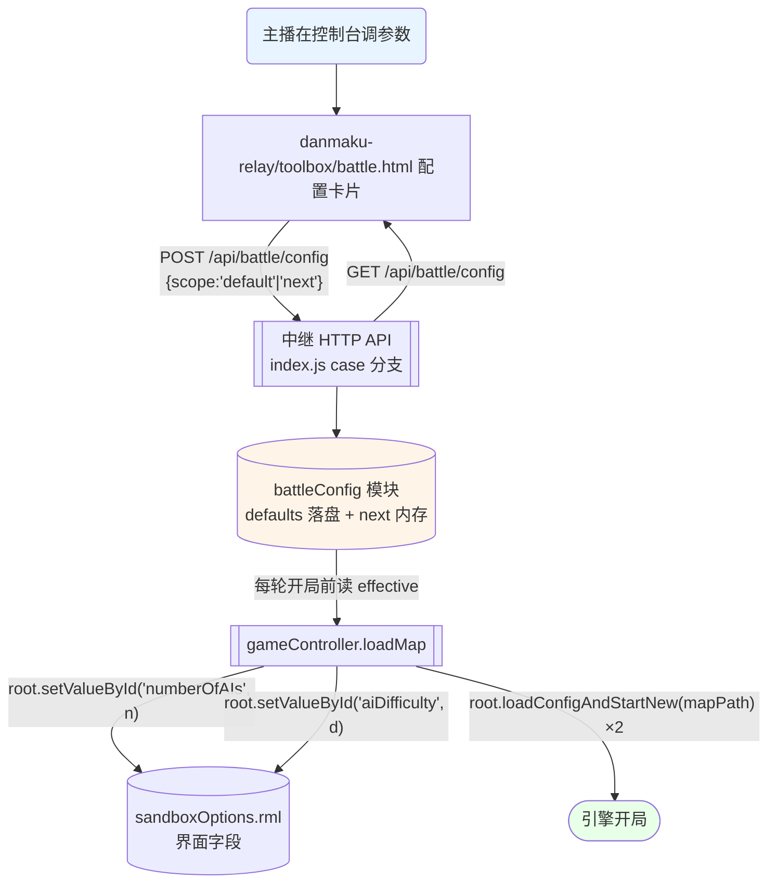

> **Model: deepseek-v4-flash (cheap)**

# 开局配置搬到弹幕对战控制台

> 承接会话：2026-09-19。用户提问「每次游戏开始不是有个配置界面吗？包括地图的选择，玩家的数量，ai的难度，迷雾与初始资金等等，这些是不是可以加到弹幕对战控制台上」。
> 用户已拍板：**① 地图选择先不开**（保持 `live_dire.tmx`）；**② 全局默认 + 单轮覆盖都要**，生效时机=`每轮开局前`。

## 需求提炼

**用户原话**：「每次游戏开始不是有个配置界面吗？包括地图的选择，玩家的数量，ai的难度，迷雾与初始资金等等，这些是不是可以加到弹幕对战控制台上。做之前先梳理总结一下我的意图与目的。」
**用户决策**：「1.先不开；2.两者都要，生效肯定是每轮开始前生效」。

- **目标**：让主播在弹幕对战控制台页面（URL：`http://127.0.0.1:8767/battle.html`，即文件 `danmaku-relay\toolbox\battle.html`）上直接调**开局参数**（AI 数量、AI 难度、队伍模式），不必切进游戏点配置界面；支持「设一次全局默认」与「只改下一轮」两种粒度；参数在**每轮开局前**生效。
- **非目标**（明确不做）：
  1. **不开放地图切换** —— 用户明确选「先不开」。当前地图冻结在 `live_dire.tmx`（`danmaku-relay\battle\index.js:162-166` 记载 9/19 因切图出过「开局 10 秒被判失联」回归）。
  2. **不做迷雾开关** —— 核实后确认 `fog` **不在** `sandboxOptions.rml` 里，它是**地图属性**（`live_dire.tmx` 的 `<properties>` 中 `name="fog"`）。要改就得动地图文件，与第 1 条冻结线冲突。
  3. **不动轮次状态机 / 判胜轮询 / 经济扣款 / 开局镜头**。本改动是纯叠加。
- **可选扩展（本轮先不做，留接口）**：初始资金。`credits` 同样是地图属性，但 `debug.setTeamCredits(team, n)`（`Debug.java:277`）能**运行时**给每队设钱，可绕道实现——标注为 Phase 2。

### 术语对齐（避免"配置界面"含义漂移）

用户说的"配置界面"= 游戏的 **Sandbox Editor 选项页**，即 `assets\gui\sandboxOptions.rml`。中继**早就在用它**（`gameController.js:203-209`：`root.open('sandboxOptions.rml', mapPath)` → `root.setValueById('aiTeams','5')` → `root.setValueById('numberOfAIs','7')` → 起局）。本任务不是"新建配置系统"，而是**把已经存在的两个硬编码值抽出来 + 补上没用的一个 + 给它一个 UI**。

## 现状与根因

**现状**：起局参数写死在代码里，控制台完全无法调。

| 参数 | `sandboxOptions.rml` 里的 id | 取值范围 | 中继现状 |
|---|---|---|---|
| AI 数量 | `numberOfAIs` | 0–7（界面默认 4） | **硬编码 7**（`gameController.js:207`） |
| 队伍模式 | `aiTeams` | 1=vs all / 2=1 ally vs all / 3=2 ally vs all / 4=3 ally vs all / 5=Free for all | **硬编码 5**（`:205`） |
| AI 难度 | `aiDifficulty` | -2 … 3（6 档，界面默认 0） | **完全没用** |
| 地图类型 | `typeSelector` | 0=Skirmish / 1=Custom / 2=Saved Game | 未用（不影响本任务） |
| 地图 | 缩略图按钮 → `showSandboxMapSelect()` | — | 冻结为 `live_dire.tmx`（用户决定不动） |

**根因**：不是"缺机制"，是**机制已存在但没有出口**——`root.setValueById(id, value)`（`Root.java:184-193`）早已被验证可用（中继正在用），缺的只是「一个能在控制台上改的值 + 一条从控制台到该值的通路」。

## 硬约束（全部来自当前源码，逐条已核）

这三条决定了 UI 的取值范围与校验，**不是可选项**：

1. 🔴 **`numberOfAIs` 必须 ≥ 4**。`danmaku-relay\battle\teams.js:20-23` 注释：引擎建 AI 的顺序是「先填奇数槽 1,3,5,7，再填偶数槽 2,4,6」⇒ **想 `team 2`（= BLUE_TEAM）存在，`numberOfAIs` 至少要是 4**。设 <4 会让蓝方整队不存在 ⇒ 观众发的蓝方弹幕全部落空。**UI 下拉只给 4–7，后端二次校验**。
2. 🟠 **`aiTeams` 改动会动摇同盟结构**。`applyHostility()` 把 `team0→盟友组1 / team1→盟友组1 / team2→盟友组2` 硬编码写入（`gameController.js:353-362` 的 `ALLY_GROUP`），FFA(`aiTeams=5`) 是这套映射成立的前提。改成非 5 的值**可能**让红蓝不再敌对 ⇒ 本轮先**只读展示 + 标灰**，实测通过再放开。
3. 🟡 **起局必须跑两遍**（`:202` 的 `for pass=1..2`）。第 1 遍解析地图时偶数队 2/4/6 尚未创建，其基地瓦片会被 `skipping unit without player` 丢掉；第 2 遍队伍齐全才全部生效。**配置必须在每一遍之前都设一次**（现有代码就是这么写的，不要"优化"成只设一遍）。

## 数据流



## 方案取舍

| 方案 | 做法 | 结论 |
|---|---|---|
| **A. 参数走 `setValueById`（推荐）** | 复用中继已在用的 `root.open('sandboxOptions.rml')` + `setValueById`，把硬编码值换成配置 | ✅ **采用**。机制已验证、与现有起局链同构、改动面最小 |
| B. 直接调 `root.loadConfigAndStartNew(mapPath, {...})` 传参 | 绕开 RML 界面直接传配置对象 | ❌ 需先摸清该重载签名（反编译树里 `loadConfigAndStartNew` 是单参 `String`），且绕开会丢"界面二次确认"语义 |
| C. 改 `preferences.ini` / 引擎设置 | 把参数写进游戏持久设置 | ❌ 这些是**单局**参数不是全局偏好；写 preferences 会影响单机模式，副作用面大 |

## 实现设计

### 改动 1（新增）：`danmaku-relay\battle\battleConfig.js` —— 配置模型

```js
/**
 * battle/battleConfig.js — 开局参数（AI 数量 / 难度 / 队伍模式）
 *
 * 两层：defaults（落盘，跨重启保留）+ next（内存，只影响下一轮）
 * effective() = defaults 被 next 覆盖后的结果，交给 gameController 起局时用。
 *
 * 🔴 硬约束（见 teams.js:20-23）：numberOfAIs < 4 时 team 2 不存在 ⇒ 蓝方整队失效。
 *    这里做**最后一道**校验，UI 与 API 各自也校验一次（三道防线）。
 */
const fs = require('fs')
const path = require('path')

const FILE = path.join(__dirname, '..', 'data', 'battle-config.json')

const LIMITS = {
  numberOfAIs: { min: 4, max: 7, def: 7 },   // <4 会让 BLUE_TEAM(2) 不存在
  aiDifficulty: { min: -2, max: 3, def: 0 }, // 界面 6 档，默认 0
  aiTeams: { min: 1, max: 5, def: 5 },       // 5 = Free for all（applyHostility 的前提）
}

function clamp (key, v) {
  const L = LIMITS[key]
  const n = parseInt(v, 10)
  if (!Number.isFinite(n)) return L.def
  return Math.min(Math.max(n, L.min), L.max)
}

let defaults = { numberOfAIs: 7, aiDifficulty: 0, aiTeams: 5 }
let next = null

function loadDefaults () {
  try {
    const raw = JSON.parse(fs.readFileSync(FILE, 'utf8'))
    for (const k of Object.keys(LIMITS)) if (raw[k] != null) defaults[k] = clamp(k, raw[k])
  } catch (e) { /* 首次运行没有文件是正常的 */ }
}
function saveDefaults () {
  try {
    fs.mkdirSync(path.dirname(FILE), { recursive: true })
    fs.writeFileSync(FILE, JSON.stringify(defaults, null, 2))
    return true
  } catch (e) { return false }
}

function setConfig (patch, scope) {
  const clean = {}
  for (const k of Object.keys(LIMITS)) if (patch[k] != null) clean[k] = clamp(k, patch[k])
  if (scope === 'next') { next = Object.assign({}, next || {}, clean) }
  else { defaults = Object.assign({}, defaults, clean); saveDefaults() }
  return { defaults, next, effective: effective() }
}
function effective () { return Object.assign({}, defaults, next || {}) }
function clearNext () { next = null }

module.exports = { LIMITS, loadDefaults, setConfig, effective, clearNext,
  get defaults () { return defaults }, get next () { return next } }
```

### 改动 2：`danmaku-relay\index.js` —— 两个 API 分支

在既有 `/api/battle/*` case 区块（`index.js:417-458`）内追加，风格与邻居一致：

```js
      case '/api/battle/config': {
        if (method === 'GET') {
          sendJSON(res, { limits: battleConfig.LIMITS, defaults: battleConfig.defaults,
            next: battleConfig.next, effective: battleConfig.effective() })
        } else {
          const scope = (body && body.scope) === 'next' ? 'next' : 'default'
          sendJSON(res, { ok: true, ...battleConfig.setConfig(body || {}, scope) })
        }
        break
      }
```

并加 `const battleConfig = require('./battle/battleConfig')` 与启动时 `battleConfig.loadDefaults()`。

### 改动 3：`danmaku-relay\battle\gameController.js` —— 起局链读配置

把 `:205-207` 的两条硬编码换掉，并补上难度：

```js
  const camCfg = ...                        // 与镜头配置并列，不冲突
  const bc = require('./battleConfig').effective()
  for (let pass = 1; pass <= 2; pass++) {
    spawner.sendCommand(`script root.open('sandboxOptions.rml', '${mapPath}')`)
    await sleep(1500)
    spawner.sendCommand(`script root.setValueById('aiTeams', '${bc.aiTeams}')`)
    await sleep(600)
    spawner.sendCommand(`script root.setValueById('numberOfAIs', '${bc.numberOfAIs}')`)
    await sleep(600)
    spawner.sendCommand(`script root.setValueById('aiDifficulty', '${bc.aiDifficulty}')`)
    await sleep(600)
    spawner.sendCommand(`script root.${START_ENTRY}('${mapPath}')`)
    await sleep(3000)
    logger.info(`[BATTLE] 起局第 ${pass}/2 遍（${START_ENTRY} / aiTeams=${bc.aiTeams} / numberOfAIs=${bc.numberOfAIs} / aiDifficulty=${bc.aiDifficulty}）`)
  }
```

**注意**：不再写死 `aiTeams=5 FFA`，日志随之改为打印实际值（便于事后对账）。

### 改动 4：`danmaku-relay\battle\index.js` —— 轮次结束后清掉 `next`

`round.on('ended', ...)` 里加 `battleConfig.clearNext()`，让「只改下一轮」真的是**只**影响一轮。

### 改动 5：`danmaku-relay\toolbox\battle.html` —— 加「开局配置」卡片

复用现有卡片样式（`.card` / `.stat` / `.btn`），插在「轮次信息」卡片之后：

```html
<div class="card" id="cfgCard">
  <h2>⚙️ 开局配置 <span style="font-size:12px;color:#b2bec3">（每轮开局前生效）</span></h2>
  <div class="stat"><span class="label">AI 数量</span>
    <select id="cfgAIs"></select></div>
  <div class="stat"><span class="label">AI 难度</span>
    <select id="cfgDiff"></select></div>
  <div class="stat"><span class="label">队伍模式</span>
    <select id="cfgTeams" disabled title="改动会影响红蓝敌对结构，暂未开放"></select></div>
  <div class="controls">
    <button class="btn btn-start" onclick="saveCfg('next')">只改下一轮</button>
    <button class="btn btn-end" onclick="saveCfg('default')">存为默认</button>
  </div>
  <div id="cfgMsg" style="font-size:12px;color:#00cec9;margin-top:8px"></div>
</div>
```

JS 侧：`loadConfig()` 拉 `GET /api/battle/config` 填下拉（**AI 数量只渲染 4–7**，其选项来自后端 `limits`，不写死）；`saveCfg(scope)` POST 后刷新并提示。

## 验证清单

**单元（无需游戏）**
- `battleConfig.clamp`：`numberOfAIs=3` → 夹到 4；`=99` → 夹到 7；`='abc'` → 回默认 7；`aiDifficulty=-5` → 夹到 -2。
- `setConfig(patch,'next')` 只动 `next` 不动 `defaults`；`effective()` 正确覆盖。
- `setConfig(patch,'default')` 落盘后 `loadDefaults()` 能读回同值。

**API（无需游戏）**
- `GET /api/battle/config` 返回 `limits/defaults/next/effective` 四段。
- `POST` 带 `scope:'next'` 后 `GET` 的 `next` 变、`defaults` 不变；`scope:'default'` 反之。
- 传越界值被夹紧，返回体里能看到夹紧后的值。

**端到端（需起游戏，约 20s/轮）**
- 控制台把 AI 数量改成 5 → 点「只改下一轮」→ 开始新一轮 → 中继日志出现 `numberOfAIs=5`；`probe` 段应只探到 team 0..5（**team 6/7 消失**，这是生效的**可观察证据**）。
- 再开一轮（不点「只改下一轮」）→ 配置**回落**到默认 7 ⇒ 「单轮覆盖」语义正确。
- 画面人工检查点：开局后队伍/基地数量与配置一致（抓帧 `capture_game_frame.py` 佐证）。

**反例（必须验，防静默失败）**
- 若 `setValueById('aiDifficulty', ...)` 是**无效调用**（id 不匹配/界面未打开），引擎日志会打 `ui[warn]: Could not find:aiDifficulty` 或 `element is null` —— **这是判定该字段是否真生效的唯一凭据**，必须逐轮 grep 引擎日志，不能只看中继日志"已发出"。

## 瑶光反证

**断言 1「`numberOfAIs` < 4 会让蓝方消失」** —— 证据：`teams.js:20-23` 注释明写引擎建 AI 先奇后偶、`team 2` 需 ≥4。**反证路径**：实机设 3 起一轮，看 `probe` 段是否只剩 team 0/1/3 —— 若 team 2 仍出现，说明该约束不成立于本 build，需修订限值。**未实测，标待验证假设。**

**断言 2「`setValueById('aiDifficulty', ...)` 会真正改变 AI 难度」** —— 证据：`sandboxOptions.rml` 里 `aiDifficulty` 有 `data-settings` 属性（与已生效的 `numberOfAIs`/`aiTeams` 同类）。**反证路径**：见验证清单的「反例」——查引擎日志有无 `Could not find:aiDifficulty`。**待实测。**

**断言 3「`aiTeams≠5` 会破坏红蓝敌对」** —— 这是**保守假设**，不来自实测。证据方向：`applyHostility` 的 `ALLY_GROUP` 硬编码在 `gameController.js:353-362`。**处理**：本轮把该下拉标灰不开放，回避该风险；将来实测确认后再开。**标注为待验证假设，不作为已证事实。**

**自我反审**：本计划最可能的自欺是「以为搬了配置就等价于游戏里手点」。中继是**用脚本代点界面**，任何一步 `setValueById` 静默失败（元素找不到）都不会抛错——所以验证必须落到**引擎日志**而非中继日志，这条已写进反例清单。

## 回归清单（改动后必须仍成立）

| # | 锚点 | 验证方式 |
|---|---|---|
| 1 | 地图仍是 `live_dire.tmx` | `index.js:166 MAP_FILE_DEFAULT` 未变；`git diff` 无 `.tmx` |
| 2 | 起局仍跑两遍 | 日志仍有 `起局第 1/2 遍` 与 `2/2 遍` |
| 3 | 默认参数与今天一致（7 / FFA） | 不改配置直接起轮 → 日志 `numberOfAIs=7 aiTeams=5` |
| 4 | 红蓝队号仍是 1 / 2 | `teams.js` 未被改动；`[SPAWN]` 仍能生红蓝双方 |
| 5 | 判胜 / 镜头 / 经济不受影响 | `npm run verify` 全绿；日志仍有 `[BATTLE][cam]` 与 `[win]` |
| 6 | 配置模块异常不阻断起局 | 传入任何非法值都能夹紧后继续，不抛 |

## 分波执行

改动跨 4 个文件、任务数 >8，按「可独立验证」切三波。

### Wave 1 — 配置模型 + API（后端）

- [ ] 新增 `battle/battleConfig.js`（含 clamp / defaults 落盘 / next 内存 / effective）
- [ ] `index.js` 加 `GET|POST /api/battle/config` + 启动时 `loadDefaults()`
- [ ] `index.js` 的 `round.on('ended')` 加 `clearNext()`

**波末验证**：`cd danmaku-relay && npm run check` 语法 rc=0；配置模块单测全过（含越界夹紧、scope 语义、落盘读回）；`GET/POST` 一来一回后 `defaults` 与 `next` 各自正确。

### Wave 2 — 控制台 UI（前端）

- [ ] `danmaku-relay\toolbox\battle.html` 加「开局配置」卡片 + `loadConfig()` / `saveCfg()`
- [ ] AI 数量下拉**从后端 `limits` 渲染**（4–7），不写死选项

**波末验证**：浏览器打开控制台页面（URL：`http://127.0.0.1:8767/battle.html`），卡片出现；下拉选项恰为 4–7；点「只改下一轮」后页面提示成功且数值保持；`aiTeams` 呈 disabled 态。

### Wave 3 — 起局接线 + 端到端（需起游戏）

- [ ] `gameController.js:203-211` 起局链改读 `effective()`，补 `aiDifficulty`
- [ ] 日志改为打印实际三项值

**波末验证**：设 `numberOfAIs=5` → 起一轮 → 中继日志 `numberOfAIs=5` 且 `probe` 段只到 team 5；**引擎日志无 `Could not find:aiDifficulty`**；再起一轮回落默认 7（单轮覆盖语义）；`npm run verify` 全绿。

## Phase 2（2026-09-19 追加）：迷雾 + 初始资金

**用户原话**：「迷雾和初始资金可以调，这个也加进去」（首次提出后重申一次）。

**⚠️ 对本计划初稿的纠正**：初稿断言「迷雾/资金是地图属性、改不了、本任务不碰」——**该断言是错的**。核实后：它们确实**不是** RML 界面字段（`sandboxOptions.rml` / `levelOptions.rml` 里都没有），但它们是**单局规则对象 `ah` 的 public 字段，运行时可写**。

### 证据（逐行核实）

`war-vote\tools\_gfdec\gf_src\com\corrodinggames\rts\gameFramework\j\ah.java:11-28`：

```java
public strictfp class ah implements Cloneable {
    public int c = 0;         // startingCredits   ← 初始资金
    public int d = 2;         // fogMode           ← 迷雾模式
    public boolean e = true;  // revealedMap
    public int f = 1;         // aiDifficulty
    public int g = 1;         // startingUnits
    public float h = 1.0f;    // incomeMultiplier
```

字段**全部 public**；`ah.java:36-46` 的 `b()` 自描述串把编号与语义一一对上（`"startingCredits: " + this.c`、`"fogMode: " + this.d`）。

`Debug.java:415-421` 有**同构先例**：

```java
public boolean networkSetIncomeMultiplier(float f2) {
    com.corrodinggames.rts.gameFramework.l l2 = com.corrodinggames.rts.gameFramework.l.B();
    ah ah2 = l2.bX.e();     // 取单局规则
    ah2.h = f2;             // 改字段
    l2.bX.a(ah2);           // 提交
    return true;
}
```

⇒ 模式已存在，只是没为 `c` / `d` 暴露方法。

**迷雾档位**（`gameFramework\j\ad.java:476-483`）：`0 = "No fog"`、`1 = "Basic fog"`、`2 = ...`；默认 `d = 2`。

**为什么不能走 `debug.setGameSetting`**：那条路是 `SettingsEngine.setValueDynamic(key,value)`（`SettingsEngine.java:217`，用 `settingFields` **按字段名反射**）。已核实 `SettingsEngine` 字段**全是客户端偏好**（音量/分辨率/渲染开关/teamColors…），`grep fog|credit|starting` **零命中** ⇒ 走不通。

### 两条路径（代价不同，分开对待）

| 项 | 路径 | 是否需改 jar |
|---|---|---|
| **初始资金** | 现成 `debug.setTeamCredits(team, n)`（`Debug.java:277`）：起局后对 RED/BLUE 各设一次 | ❌ **不需要** |
| **迷雾** | 无现成 API ⇒ 复用 `_reports\cam-research\_inject\` 设施**再注入** `Debug.setFogMode(int)` + `Debug.setStartingCredits(int)` | ✅ **需要**（第二次注入，需停游戏约 5s） |

### 注入实现（复用 CamPatcher 设施，build/apply 脚本不变）

在已有 getter 旁追加两个 setter，照抄 `networkSetIncomeMultiplier` 的三步模式：

```java
public boolean setFogMode(int n) {
  try {
    com.corrodinggames.rts.gameFramework.l l2 = com.corrodinggames.rts.gameFramework.l.B();
    if (l2 == null) { return false; }
    com.corrodinggames.rts.gameFramework.j.ah a = l2.bX.e();
    if (a == null) { return false; }
    a.d = n;
    l2.bX.a(a);
    return true;
  } catch (Throwable t) { return false; }
}
public boolean setStartingCredits(int n) { /* 同上，改 a.c */ }
```

中继侧用 `script debug.setFogMode(n)`（`script` 前缀，与 `setTeamAllyGroup` 同源）。

### 配置项（并入同一个 battleConfig）

| 键 | 取值 | 默认 | 生效方式 |
|---|---|---|---|
| `fogMode` | 0=No fog / 1=Basic fog / 2=默认 | 2 | 起局后发 `script debug.setFogMode(n)` |
| `startingCredits` | 整数；**0 视为「不改，用地图默认」** | 0 | 用注入的 `setStartingCredits(n)`（规则级，更贴近"初始资金"语义） |

⚠️ **与地图属性的关系**：`live_dire.tmx` 自带 `fog` / `credits` 属性（`gameFramework\n\f.java:332` 读 `credits` 设队资金）。运行时配置是**覆盖**——所以 `startingCredits=0` 必须解释为「不改」，否则会把地图的合理默认冲成 0，那种"配置反而弄坏了"是最典型的自伤。

### Phase 2 验证清单

- `setFogMode(0)` 后抓帧对比 → 雾效消失（`capture_game_frame.py` 前后帧）。
- `setStartingCredits(50000)` 后读 `econ_live.txt` 的 `team 1/2` 余额 ≈ 设定值。
- **反例（必验）**：方法若未被 `ScriptEngine` 反射注册，引擎日志会打 `Could not find:setFogMode` —— 必须 grep **引擎日志**确认，不能只看中继"已发出"。

## Phase 2 实测结论（2026-09-19 19:33）—— 一项成、一项败

| 项 | 结果 | 证据 |
|---|---|---|
| **初始资金** | ✅ **可用** | `debug.setTeamCredits(1,50000)` → `econ_live.txt` 的 team 1 由 **100918 → 50182**（差 ~180 = 读写间隔 1.6s × 111/s 收入，吻合）。已接入起局链（`gameController.js` loadMap 末尾，`startingCredits > 0` 时发） |
| **迷雾（改 `ah.d`）** | ❌ **单机下不可行** | 注入的 `setFogMode` 被引擎调用（日志有 `ScriptEngine:HandleEvent:debug.setFogMode(0)`），但随后打 **`applyChangedSetup but not server or proxy controller`**；换 `bX.ay` 后同样被拒（`getChangeableSetup:Clicked but not server or proxy controller`）。⇒ `ah` 是**多人房间配置**对象，单机沙盒下引擎拒绝应用 |

**迷雾的真正归属（已确证）**：它是**地图属性**（`live_dire.tmx` 的 properties `fog`），在**地图加载时**由 `gameFramework\n\f.java:332` 读取生效。想改只有两条路，都不属于"控制台可调"：
1. 改地图文件（用户已决定不动地图 —— 与本计划「地图先不开」一致）；
2. 让引擎以"服务器/代理"身份运行（不在本项目形态内）。

⇒ **UI 已把迷雾下拉标灰**并写明原因，避免给出一个按了没反应的开关。

**端到端实测（19:33，同一轮）**：

```
起局第 1/2 遍（loadConfigAndStartNew / aiTeams=5 / numberOfAIs=5 / aiDifficulty=2）
初始资金已设为 60000（红 team1 / 蓝 team2）
[BATTLE][cam] 开局镜头 → 焦点(1100, 1078.4) 缩放0.57870376
[probe] team 1..5 = "AI - Very Hard"   ← 只剩 5 队且难度改变
[probe] team 6..9 = "<NULL>"            ← team 6/7 确实消失
```

⇒ AI 数量 / AI 难度 / 初始资金 **三项均实测生效**。

**jar 版本记录**：本阶段新增 `Debug.setFogMode` / `Debug.setStartingCredits`（fog 那个虽注入但单机无效，保留以备将来有多人形态）。当前 `game-lib.jar` sha256 `D64DFAB7339DB4C3`；回滚备份 `game-lib.jar.bak-fog2-*`。
