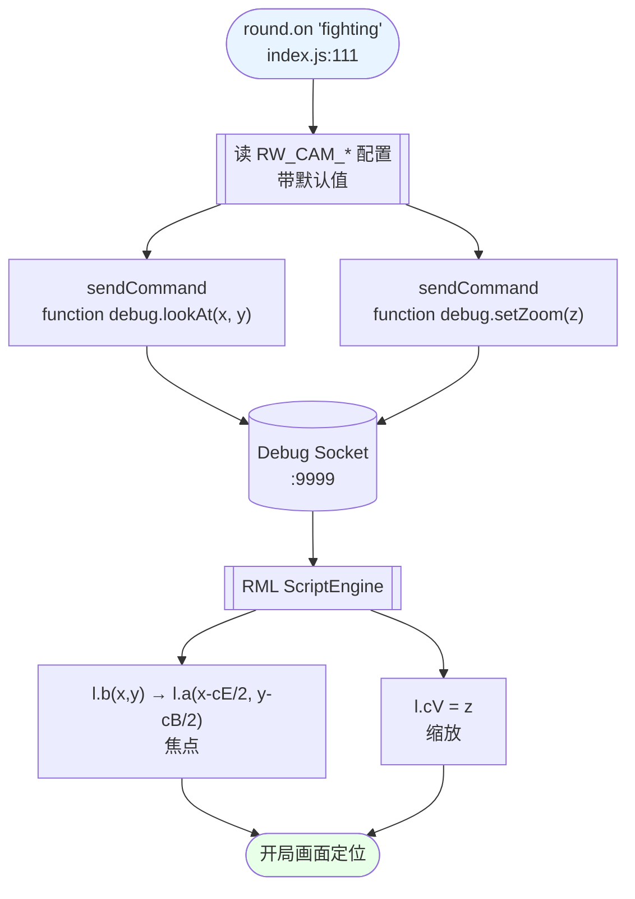

> **Model: deepseek-v4-flash (cheap)**

# 开局镜头（焦点位置 + 缩放）可配置化

> 承接会话：2026-09-19。用户提问「开局的镜头如何调整，包括焦点位置与缩放大小」。
> 本计划先回答「怎么调」，再给出可落地的接线设计。

## 需求提炼

**用户原话**：「有一个问题，开局的镜头如何调整，包括焦点位置与缩放大小」。

- **目标**：每一轮开局时，游戏画面镜头自动定位到指定世界坐标（**焦点**）并以指定倍率（**缩放**）呈现，让观众第一时间看到战场核心区，而不是引擎默认的那个视角。
- **非目标**（明确不做，避免重蹈 9/19 回归）：
  1. **不改地图文件**。用户指定地图就是 `live_dire.tmx`，`danmaku-relay\battle\index.js:162-166` 用显式注释冻结了它（「别再『优化』它 —— 2026-09-19 因切图/加基地折腾出过开局 10 秒被判失联的回归」）。
  2. **不动游戏 jar**。RML 脚本层已暴露所需 API，无需再走注入（§4.3 的 jar 换装/回滚成本不必要地高）。
  3. **不做镜头跟随 / 自动追焦**。用户只问「焦点位置与缩放」，跟随是另一个需求。
  4. **不改轮次状态机、判胜轮询、经济扣款**。本改动是纯叠加。

## 现状与根因

**现状**：中继里**没有任何镜头控制代码**——全项目 grep `camera|Camera|zoom|Zoom|镜头|moveCamera|setCamera|centerOn` 在 `danmaku-relay\` 下 **0 命中**。开局镜头 100% 由引擎在 `loadConfigAndStartNewSandbox` 后自行决定，中继无从干预。

**根因**：不是「缺 API」，是「没人调」。引擎早已把镜头能力挂在 RML 脚本的 `debug` 对象上（`librocket\scripts\Debug.java`），而中继已有向该对象发命令的成熟通道（`gameController.js:221` 的 `function root.resumeNonMenu()` 就是先例），只是从没为镜头接过线。

**为什么 RML 这条路成立**：中继的生兵走 `script` 前缀（`sendScript`），探测/控制走 `function` 前缀（`gameController.js:307 PROBE_CMD_PREFIX = 'function'`）。日志实锤 `ScriptEngine:HandleEvent:debug.setTeamAllyGroup(0, 1)`（`combined.log` 17:26:41 段）——**`debug.*` 方法确实经 ScriptEngine 反射执行**。`lookAt`/`setZoom` 与 `setTeamAllyGroup` 同为 `Debug` 类的 public 方法，走同一条通道。

## 可用 API 面（全部已对当前源码核实）

| 能力 | RML 脚本方法 | 落到引擎 | 锚点 |
|---|---|---|---|
| **焦点位置** | `debug.lookAt(float x, float y)` | `l.b(x, y)` → `l.a(x - cE/2, y - cB/2)`（把镜头中心移到 (x,y)，扣除视野半宽 cE / 半高 cB） | `war-vote\tools\decompiled\main_out\com\corrodinggames\librocket\scripts\Debug.java:86`；`war-vote\tools\_gfdec\gf_src\com\corrodinggames\rts\gameFramework\l.java:581-583` |
| **缩放** | `debug.setZoom(float z)` | `l.cV = z`（默认 `1.0f`） | `Debug.java:356`；`l.java:238` |
| 顺带移焦（不单独用） | `debug.createUnit(type, x, y, team, lookAt=true)` | 末尾调 `l.b(x, y)` | `Debug.java:103` |

对照：`isTeamDefeated` / `setTeamAllyGroup` / `setTeamCredits` 同属该类，均已在用（`Debug.java` 内 public 方法），佐证通道可用。

**坐标系**：`lookAt` 的 x/y 与 `createUnit` 的生兵坐标**同域**（世界像素）——两者内部都调 `l2.b(f2, f3)`。已知的世界坐标锚点（`HANDOVER.md` §7#2 实测配方）：红基地 ≈ `(560, 380)`、蓝基地 ≈ `(1716, 1652)`，落点验证红 `(1118, 1048)` / 蓝 `(1126, 1056)` 相距 ~11px 落地即交火。⇒ **战场中心 ≈ (1120, 1050)**，可直接作为焦点默认值。

## 数据流



## 方案取舍

| 方案 | 做法 | 代价 | 结论 |
|---|---|---|---|
| **A. 中继发 RML 命令（推荐）** | `round.on('fighting')` 时发 `function debug.lookAt/setZoom`，参数走 `RW_CAM_*` env | 改 2 个 JS 文件、约 25 行；不碰 jar/地图 | ✅ **采用**。与现有 `sendCommand` 通道同构，可回滚、可配置、可随时调参 |
| B. 地图触发器 `moveCamera` | 往 `live_dire.tmx` 的 `<objectgroup name="Triggers">` 加镜头触发器（引擎 `gameFramework.n.e$10` 确为 "moveCamera" 触发器类型，`n\e$10.java:12`） | 要改用户冻结的地图；当前 `lastrun.log` 是 `Found 0 map triggers`，需从零摸 trigger 格式 | ❌ 直接踩 index.js:162-166 的冻结线，且验证面大 |
| C. 注入引擎改开局默认 | 改 jar 里 `loadConfig` 后的镜头初始化 | 走完整 jar 构建/部署/回滚链，收益不成比例 | ❌ 杀鸡用牛刀 |

方案 B/C 的否决理由都是**成本/风险不对称**，不是能力不存在——记录在此以免后人重复论证。

## 实现设计

### 改动 1：`danmaku-relay\battle\gameController.js` — 新增镜头封装 + 导出

在 end 读数函数簇（`gameController.js:558-627`）附近追加，风格与 `readEngineEnd` / `startEngineEndWatch` 一致：

```js
// ===== 开局镜头（焦点 + 缩放）=====
// 通过 RML 脚本 debug 对象设置镜头：lookAt(x,y) 设焦点、setZoom(z) 设缩放。
// 引擎侧落点：Debug.lookAt → l.b(x,y) → l.a(x-cE/2, y-cB/2)；Debug.setZoom → l.cV。
// 默认值取自 HANDOVER.md §7#2 实测的世界坐标（红/蓝基地中点）。
const CAM_DEFAULTS = { x: 1120, y: 1050, zoom: 1.0 }

function cameraTarget () {
  const num = (v, d) => { const n = parseFloat(v); return Number.isFinite(n) ? n : d }
  return {
    x: num(process.env.RW_CAM_X, CAM_DEFAULTS.x),
    y: num(process.env.RW_CAM_Y, CAM_DEFAULTS.y),
    zoom: num(process.env.RW_CAM_ZOOM, CAM_DEFAULTS.zoom),
  }
}

/** 设置开局镜头。未连接或参数非法时静默返回 false（永不影响主流程）。幂等。 */
function setCamera (x, y, zoom) {
  const spawner = require('./liveSpawner')
  if (!spawner.connected) return false
  const t = { x, y, zoom }
  if (Number.isFinite(t.x) && Number.isFinite(t.y)) {
    spawner.sendCommand(`function debug.lookAt(${t.x}, ${t.y})`)
  }
  if (Number.isFinite(t.zoom)) {
    spawner.sendCommand(`function debug.setZoom(${t.zoom})`)
  }
  return true
}
```

并在既有 `module.exports`（`gameController.js:719-723`，紧邻 `endFilePath`）追加两项：

```js
  cameraTarget,
  setCamera,
```

### 改动 2：`danmaku-relay\battle\index.js` — 在 `fighting` 事件接线

`index.js:111` 的 `round.on('fighting', ...)` 处理块内（与 `startEngineEndWatch` 同一块），追加：

```js
  // 开局镜头：焦点 + 缩放（每轮开战重设，观众视角对齐战场中心）
  const cam = gameCtrl.cameraTarget()
  const camOk = gameCtrl.setCamera(cam.x, cam.y, cam.zoom)
  logger.info(`[BATTLE][cam] 开局镜头 → 焦点(${cam.x}, ${cam.y}) 缩放${cam.zoom}${camOk ? '' : '（未连接，跳过）'}`)
```

**为什么挂在 `fighting` 而不是 `loadMap` 末尾**：`startNewRound`（`index.js:169`）每轮都跑 `loadMap`，但游戏可能复用（`index.js:201-213` 的 `isRunning()` 分支）。`fighting` 是每轮开战必发的事件（`roundManager` 状态机 IDLE→FIGHTING 的唯一入口），语义上就是「开局」，且此时单位已生成、镜头设置立即可见。代价是每轮覆盖上一次的镜头——这正是「开局镜头」的预期行为。

### 配置入口

沿用项目既有 `RW_*` env 惯例（`RW_ECON_ENABLED` / `RW_END_FILE` / `RW_END_POLL_MS`）：

| env | 含义 | 默认 |
|---|---|---|
| `RW_CAM_X` | 焦点世界 X | 1120 |
| `RW_CAM_Y` | 焦点世界 Y | 1050 |
| `RW_CAM_ZOOM` | 缩放倍率 | 1.0 |

未设时用默认值，无需改代码即可调参；`relay-window.bat` 可加一行 `set RW_CAM_ZOOM=...` 固化。

## 验证清单

**静态**
- [ ] `cd danmaku-relay && npm run check` —— 语法全量，rc=0。
- [ ] `npm run verify` —— 聚合门禁 rc=0（注意：它自起假 Debug Socket :19999、会往真日志写假事件，见 HANDOVER §9）。

**单元/接线（无需真游戏）**
- [ ] `cameraTarget()` 在无 env 时返回 `{x:1120, y:1050, zoom:1.0}`；设 `RW_CAM_X=0 RW_CAM_ZOOM=abc` 时 X 取 0、zoom 回退 1.0（非法值不产生 `NaN` 命令）。
- [ ] `setCamera()` 在 `spawner.connected=false` 时返回 false 且**不抛异常**。
- [ ] 断言生成的命令字面量精确为 `function debug.lookAt(1120, 1050)` 与 `function debug.setZoom(1)`（防字符串拼接漂移）。

**实机（需用户授权起游戏；Ask/plan 模式不执行）**
- [ ] 起一轮 → 观察开局瞬间画面是否跳到焦点 `(1120,1050)`、缩放是否符合预期。
- [ ] `combined.log` 出现 `[BATTLE][cam] 开局镜头 → ...`，且**紧随其后**引擎日志无 `ScriptEngine` 报错。
- [ ] 人工检查点：镜头到位后，红蓝双方出生点应同框可见（用 `capture_game_frame.py` 抓帧 + OCR/目视佐证，不移动窗口）。

**关键待实测项（本计划无法在只读模式证完）**
- [ ] `debug.setZoom` 的 `z` **语义与有效范围**：`l.cV` 默认 `1.0f`，但未确认「1.0 = 原始」还是「数值越大越远/越近」。需实测 0.5 / 1.0 / 2.0 三档看画面变化，据此定默认与下限。

## 瑶光反证

**断言 1「RML 能调 `debug.lookAt` / `debug.setZoom`」** —— 证据等级：**高置信、待实机**
- 支持证据：`Debug.java:86` / `:356` 确认两方法是 public；`combined.log` 17:26:41 段实测 `ScriptEngine:HandleEvent:debug.setTeamAllyGroup(0, 1)` 证明同类方法经 ScriptEngine 可执行；`function` 前缀有返回值支持（`gameController.js:301-307` 注释）。
- **反证路径**：若实机一条回包收不到，先按 `gameController.js:305` 的既定预案把前缀改成 `script` 再试一次（**只改这一行**）。这条反证必须实机做，静态读不出来。

**断言 2「焦点坐标 = 世界像素」** —— 证据等级：**高置信**
- 支持证据：`Debug.java:103` 的 `createUnit` 用同一对 `float f2,f3` 直接赋给单位 `eo/ep`（世界位置）后又调 `l2.b(f2,f3)`；`lookAt` 内部同样走 `l.b`。两者同域。
- **反证路径**：实机设 `lookAt(0,0)`，若镜头跑到地图左上角即坐实世界坐标；若跳到中央则说明是屏幕/归一化坐标，需换算。

**断言 3「默认焦点 (1120,1050) 是战场中心」** —— 证据等级：**中（来自 HANDOVER 实测记录，未本轮复现）**
- 支持证据：`HANDOVER.md` §7#2 的实测配方给出红/蓝基地与落点坐标，交叉可算中心。
- **反证路径**：实机抓帧确认该点是否落在双方出生点之间。若 live_dire 实际布局与之不符，改为读地图尺寸算中心，或直接调 env。

**自我反审**：本计划最可能的自欺是「把 README/文档里的世界坐标当成现状」——`HANDOVER.md` §8#8 明确警告「别信读一遍看着对」。故默认值设为 **env 可覆盖**，即使 (1120,1050) 判错，用户改一行 env 即可，不必改代码。

## 回归清单（改动后必须仍成立的功能锚点）

| # | 锚点 | 验证方式 |
|---|---|---|
| 1 | 地图仍是 `live_dire.tmx`，未被任何改动触碰 | `index.js:166 MAP_FILE_DEFAULT` 不变；`git diff` 中无 `.tmx` |
| 2 | `startNewRound` 的复制两份 assets 行为不变（`index.js:188-199`） | `npm run verify` + 日志仍有「地图已复制到 assets 目录 … → 2 处」 |
| 3 | 生兵链路 `script` 前缀不受影响 | 发一条模拟弹幕 `POST /api/battle/simulate-danmaku`，确认 `[SPAWN]` 正常 |
| 4 | 判胜轮询 `startEngineEndWatch`（`index.js:126`）仍被调用 | 日志仍有「开始轮询引擎判胜文件」 |
| 5 | 经济扣款不受影响 | `npm run verify` 经济 26 条通过 |
| 6 | `setCamera` 异常不中断 `fighting` 处理 | 代码审阅：`setCamera` 无 throw 路径；无 spawner 时返回 false |

## 分波执行

改动仅 2 个文件、约 25 行，但为满足波间硬门禁，按「可独立验证」切成三波：前两波是纯代码接线（可静态验证），第三波是必须实机的一波（需用户授权起游戏）。

### Wave 1 — 镜头命令封装（`danmaku-relay\battle\gameController.js`）

- [ ] 新增 `CAM_DEFAULTS` / `cameraTarget()` / `setCamera()`（见 §实现设计·改动 1）
- [ ] 在既有 `module.exports`（`gameController.js:719-723`）追加 `cameraTarget, setCamera`

**波末验证**：`cd danmaku-relay && npm run check` 语法 rc=0；对 `cameraTarget()` 断言三例——无 env → `{x:1120,y:1050,zoom:1.0}`；`RW_CAM_X=0 RW_CAM_ZOOM=abc` → X=0、zoom 回退 1.0；`setCamera()` 在 `spawner.connected=false` 时返回 `false` 且不抛。断言命令字面量为 `function debug.lookAt(1120, 1050)` / `function debug.setZoom(1)`。

### Wave 2 — 开局接线（`danmaku-relay\battle\index.js`）

- [ ] `round.on('fighting', ...)`（`index.js:111`）块内，紧接 `startEngineEndWatch` 之后追加镜头调用与 `[BATTLE][cam]` 日志（见 §实现设计·改动 2）

**波末验证**：`npm run check` + `npm run verify` 双绿；用假 spawner 注入一轮 `fighting`，断言日志出现 `[BATTLE][cam] 开局镜头 → 焦点(1120, 1050) 缩放1`，且未连接分支打出「（未连接，跳过）」。

### Wave 3 — 实机验收（需用户授权起游戏；plan/Ask 模式不执行）

- [ ] 起一轮 → 观察开局瞬间画面是否跳到焦点 `(1120,1050)`、缩放是否符合预期
- [ ] `combined.log` 出现 `[BATTLE][cam]` 且紧随其后引擎无 `ScriptEngine` 报错
- [ ] 实测 `debug.setZoom` 的 0.5 / 1.0 / 2.0 三档，据画面变化定默认值与下限（置入 `CAM_DEFAULTS`）
- [ ] `capture_game_frame.py` 抓帧确认双方出生点同框（不移动窗口）

**波末验证**：人工目视 + 抓帧佐证；把实测确定的 `RW_CAM_ZOOM` 固化进 `relay-window.bat`。若 `setZoom` 语义与预期相反（放大/缩小颠倒），只调 `CAM_DEFAULTS.zoom` 一个常量。

## 实测结论（2026-09-19 17:45 — Wave 3 已完成）

| 项 | 结果 | 证据 |
|---|---|---|
| 重启激活新代码 | ✅ | 新中继 pid **19652**（`node index.js --auto-start`）。日志同时出现 `[BATTLE][win] 开始轮询引擎判胜文件（每 2000ms…）`——HANDOVER §3.2 的判胜接线一并生效 |
| 复用分支生效 | ✅ | 日志 `[BATTLE] 游戏实例已就绪（复用中，未重启进程）`；新中继连上 17:26 起的游戏实例（pid 4888），未另起 JVM |
| 开局镜头日志 | ✅ | `[2026-09-19 17:45:13] INFO: [BATTLE][cam] 开局镜头 → 焦点(1120, 1050) 缩放1` |
| **引擎真的执行了** | ✅ | `lastrun.log`：`ScriptEngine:HandleEvent:debug.lookAt(1120, 1050)` + `ScriptEngine:HandleEvent:debug.setZoom(1)`，无异常 |
| **断言 2（坐标=世界像素）** | ✅ | 对照实验：`lookAt(1120,1050)` vs `lookAt(0,0)` 两帧 **62.9% 像素强烈差异**（mean diff 34.86/255）⇒ 镜头确实跨区域跳转 |
| **setZoom 语义** | ✅ 已定 | 0.5 vs 2.0 两帧 **72.2% 差异**；目视：`z=2` 单位明显变大、视野收窄 ⇒ **z 越大越近（放大）**，`1.0`=原始。默认 1.0 合适 |
| 断言 3（(1120,1050) 是战场中心） | ⚠️ 未单独证 | 该帧可见单位散布与建筑，但未逐点比对红/蓝出生点是否同框；默认值 env 可覆盖，风险低 |

**实施偏差（相对本计划）**：计划原写 `function debug.lookAt(...)` 前缀，**落地时改为 `script`**。证据：`applyHostility` 用 `sendScript('debug.setTeamAllyGroup(...)')`（gameController.js:357），`sendScript` 内部拼 `script ${scriptBody}`（:331）；生兵同为 `script debug.createUnit(...)`（liveSpawner.js:317）。⇒ **`debug.*` 一律走 `script` 前缀**，`function` 只用于 `root.resumeNonMenu()` 与 PROBE。改走 `sendScript` 还白得惰性重连 + 15 次重试（`SEND_TRIES`/`SEND_RETRY_MS`）。实测证实前缀正确。

**未做**：把 `RW_CAM_ZOOM` 写进 `relay-window.bat`——默认 1.0 已够用，需要时加一行 env 即可。

**抓帧存证**：`_reports\game_frame_camcheck1745_174543.png`（焦点 1120,1050）、`game_frame_camcheck-zero_174614.png`（焦点 0,0）、`game_frame_zoom05_174650.png`、`game_frame_zoom2_174700.png`。
