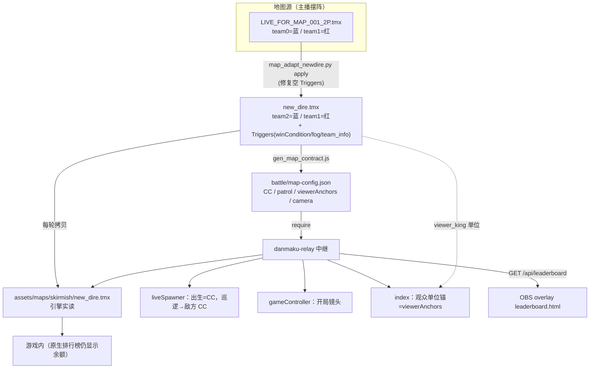

> **Model: deepseek-flash (cheap)**

**执行状态：** 已闭环。Task 1-6 均已完成；验证通过；交付门检查：GREEN。

> **Status: APPROVED** — 2026-09-27T04:37:24.999Z

> **Status: EXECUTED** — 2026-09-27T04:53:41.945Z

# 换直播地图 LIVE_FOR_MAP_001_2P + 地图配置通用化 + 观众/排行榜外置 + 兵种四分类

## 需求提炼

**用户原话提炼的目标**（本次会话起点 = 一张新 TMX + 5 条要求）：

1. **换图**：切到主播刚在沙盒摆好的 `D:\game\...\mods\maps\LIVE_FOR_MAP_001_2P.tmx`。红蓝两阵营仍由 **AI 托管**；观众召唤的兵**与之前一样下发巡逻令、避免被本队 AI 拦截**。
2. **兵种四分类模板**：召唤兵种由主播指定，分 **land / sea / air / building** 四类，先准备一份**模板文档**（主播稍后填兵种范围）。
3. **排行榜解耦**：游戏内已有排行榜，但已被用于显示余额；榜单数据本质上可与游戏解耦 —— 想放"游戏外"，直播时可**直接获取这部分并显示**，或由我提出更好的方法。
4. **观众图像与名字**：照旧需要（viewerking 机制）；因换图 **摆放位置要改**；主播已在地图里两阵营**各放一个 viewer_king 当基准**，"以这个为基准展开就行"。
5. **规范化（不删旧设计）**：之前的地图相关设计**不要删**（之后可能切回）；且**最好做成规范**，以后每次新地图兼容好、共用一套逻辑 —— "以后就是换个地图的事"。

**非目标（本次明确不做）**：
- 不改抖音/B站适配器链路与弹幕指令语义（"无红/蓝前缀不发兵"保留）。
- 不删旧图/旧配置（`new_dire*.tmx`、`live_dire.tmx` 等保留，可切回）。
- 不重做注入 jar（优先用既有 `Debug.spawnRep/addAvatar/addLabel/addWall` API；仅当 viewer 基准确需新能力才评估）。
- 不启动/重启游戏或中继，除非到 Wave 6 且**先经用户同意**（项目红线：启停服务先征得同意；当前游戏正在运行 PID 7948）。

## 现状（file:line 取证，均本轮独立读取）

**新图实况**（`D:\game\...\mods\maps\LIVE_FOR_MAP_001_2P.tmx`，220 KB）：
- 尺寸 **230×180 瓦片**（20px/瓦片 → 世界 4600×3600），远大于旧图 new_dire 的 110×110。
- 图层：`Ground`(L6926) + `Items`(L6931)，**无 `set` 层**（可省，spec 已记）。
- `Triggers`(L6937) = **`<objectgroup name="Triggers"/>`（空、自闭合）** —— 关键。
- `UnitObjects`(L6939)：**team0=75 / team1=73**，含 Ek 系 mod 建筑 + 原版炮塔。
- 指挥中心：**蓝(team0) @ (1315,1735)**、**红(team1) @ (3255,1835)**；viewer_king：**team0 @ (740,1540)**、**team1 @ (3860,1640)**。
- Ground md5 = `bf3892c5…`（与旧图不同 → 坐标必须重取）。
- tileset 含大量 `*shallowwater* / water2deepwater` 过渡表 → **可能含水域（待验）**。

**中继的地图几何硬编码**（换图要动的全部点）：

| 位置 | 值 | 现状 |
|---|---|---|
| `danmaku-relay/battle/liveSpawner.js:364` COMMAND_CENTER | 红(455,355)/蓝(1775,1695) | 写死=旧图 new_dire，注释自带"换图必须重取" |
| `danmaku-relay/battle/liveSpawner.js:369` CC_SPAWN_PAD | 45 | 写死 |
| `danmaku-relay/battle/liveSpawner.js:401` PATROL_TARGETS | 红→(1716,1652)/蓝→(560,380) | 写死=**更旧的 live_dire**，与当前 CC 已错位（半耦合缺陷） |
| `danmaku-relay/battle/gameController.js:682` CAM_DEFAULTS | (1100,1078.4)/zoom 0.5787 | 写死（唯一支持 env 覆盖） |
| `danmaku-relay/battle/index.js:277` MAP_FILE_DEFAULT | `new_dire_nomoo.tmx` | 写死；与适配工具 DST `new_dire.tmx` 不一致 |
| `danmaku-relay/battle/index.js:501-503` REP_GRID_* | cols8/dx54/dy46 | 写死 |
| `danmaku-relay/battle/index.js:549-554` 观众网格锚点 | SPAWN_AREAS 中点 + 偏移(-130,-120) | 锚在**指挥中心**，非地图 viewer_king |
| `danmaku-relay/battle/teams.js:31-35` 队号 | 红1/蓝2/观众宿主3,4 | 写死，注释称"与地图绑定" |
| `danmaku-relay/tools/map_adapt_newdire.py:47-94` | GAME/SRC/DST + TRIGGERS 摆位 | 写死 |

**适配工具与复核**：现有 `danmaku-relay/tools/map_adapt_newdire.py`（源 team0=蓝/team1=红 → 产物 team2=蓝/team1=红 + 覆盖 Triggers 为直播模板）。独立复核 `.rivet/skills/switch-map/scripts/verify_adapted_map.py`（正则，只认 `unit`）+ `danmaku-relay/tools/verify_units_et.py`（XML 通道，认 `customUnit`）。

**观众代表注入 API**（`_reports/viewer-label/_inject/src/LabelPatcher.java`）：`spawnRep(type,x,y,team,key)`、`removeRep(key)`、`addLabel(s,wx,wy,key)`、`addAvatar(path,wx,wy,key)`、`addWall(path)`（屏幕左上固定网格，与世界坐标无关）、`clearWall()`、`clearLabels()`。

**原生排行榜**（`_reports/econ-research/E1-native-dual-display.md`、`F1-dual-hud-bars.md`）：引擎 `f/k.java` 常驻叠层，type=`credits`+grouping=`allyGroup` 即"各队余额同屏"，配置在设置页 `leaderboard.rml`。这就是用户说的"游戏里已用于显示余额的排行榜"。

**可用 mod**：`preferences.ini` modSettings 中 `8561.rwmod`(=EK_Definitive)、`europ`、`worldmap`、`probe_viewer` 均 **enabled** ⇒ 新图 Ek* 单位可加载。

**弹幕兵种现状**：`danmaku-relay/battle/liveSpawner.js` 的 `UNIT_MAP`(原版) + `MOD_UNIT_MAP`(白名单 `danmaku-relay/battle/mod-unit-pool.json` 46 个)；`danmaku-relay/battle/mod-units.json` 431 单位，`category` 7 类（陆战145/悬浮两栖18/空中72/海面25/防御建筑72/建筑设施69/实验级30）。

**验证入口**：`danmaku-relay/package.json` 17 个 `verify:*` + `check` + 硬编码 `&&` 串联的 `verify` 总闸；`danmaku-relay/tools/` 下 5 个 `map_*.py` 与 `verify_units_et.py` 无 npm 入口。

## 反证 / 复现

设计定稿前对关键断言做复现（不取信声称，取物理证据）：

1. **新图 Triggers 是空自闭合标签** ✅ 复现：`grep '<objectgroup name='` → `L6937: <objectgroup name="Triggers"/>`（`L6926  Ground`、`L6931 Items`、`L6939 UnitObjects`）；`read_file` L7800-7830 见末尾为 `…viewer_king…</objectgroup></map>`。
2. **现有 `danmaku-relay/tools/map_adapt_newdire.py` 对本图会崩溃（⚠ 高置信推断，未实跑）**：其 `_TRIGGERS_RE`（`:112`）对 `<objectgroup name="Triggers"/>`：`[^>]*` 吃掉 `/`、`>` 匹配自闭合 `>`，随后 `.*?</objectgroup>`（`re.S`）一路吞到 **UnitObjects 的 `</objectgroup>`** ⇒ `transform()` 先 `_TRIGGERS_RE.sub` 抹掉整段 UnitObjects，再 `_UNITOBJ_RE.search(out)` 返回 None ⇒ `m2.group(2)` 抛 `AttributeError`。**未实跑（plan mode 禁 bash），Wave 1 第一件事是写单测把它钉成 RED/GREEN。**
3. **PATROL_TARGETS 与当前地图 CC 错位** ✅ 复现：`liveSpawner.js:362` 注释自证"旧图 live_dire CC 在 (560,380)/(1716,1652)，与 PATROL_TARGETS 一致"，而 `:364` COMMAND_CENTER 已是 new_dire 值 ⇒ 出生点与巡逻目标分属两张图，偏差 50-105px。既存半耦合缺陷，正是本任务第 5 点要根治的。
4. **旧图可切回** ✅：`<GAME>/mods/maps/` 下 `new_dire.tmx`、`new_dire_nomoo.tmx`、多份 `.bak-*` 均在。
5. **水域是否存在** ⚠ 待验证：scout 因无 bash 未解码 Ground 层；Wave 2 用 `_archive/ccresearch-game/terrain_at.py --scan` 定论（其名判据可能对过渡表假阴性，需一并核对）。

## 设计

### D1. 地图契约（Map Contract）—— 第 5 点"共用一套逻辑"的核心

新增**地图契约提取器**：解析"适配后产物 TMX"，输出机器可读的 `danmaku-relay/battle/map-config.json`【新增】，把所有地图几何量集中到一处：

```json
{
  "map": "new_dire.tmx", "width": 230, "height": 180, "tile": 20,
  "teams": { "red": 1, "blue": 2, "redViewer": 3, "blueViewer": 4 },
  "commandCenters": { "red": {"x":..,"y":..}, "blue": {"x":..,"y":..} },
  "spawnPad": 45,
  "patrolTargets": { "red": {"x":..,"y":..}, "blue": {"x":..,"y":..} },
  "viewerAnchors":  { "red": {"x":..,"y":..}, "blue": {"x":..,"y":..} },
  "camera": { "x":.., "y":.., "zoom":.. },
  "hasWater": true, "waterRegions": [...]
}
```

- `commandCenters` ← UnitObjects 里红/蓝的 `commandCenter` 坐标。
- `patrolTargets` ← 对面阵营的指挥中心（红→蓝 CC、蓝→红 CC），**自动推导，消除错位**。
- `viewerAnchors` ← UnitObjects 里的 `viewer_king`（按 team），**第 4 点的"基准"**。
- `camera` ← 红蓝 CC 中点 + 地图尺寸推导 zoom（或读 env 覆盖）。
- `hasWater/waterRegions` ← Ground 层解码后判定（供 sea 分类用）。

中继 `liveSpawner.js / gameController.js / index.js` 改为**读 map-config.json**（缺文件时回退现有写死常量，保证可切回旧图）。换图流程 = `map_adapt apply` → `gen_map_contract` → 重启中继，**改地图不改代码**。

### D2. viewer 基准（第 4 点）
`danmaku-relay/battle/index.js` `spawnRepUnit` 网格锚点从 `SPAWN_AREAS` 中点改为 `map-config.viewerAnchors[team]`（地图 viewer_king 坐标）。地图里的 viewer_king 单位**保留**（可视化锚点），中继动态观众单位在其周围展开；`REP_GRID_*` 改从 map-config 读（带默认）。

### D3. 兵种四分类模板（第 2 点）
新建 `docs/兵种分类模板.md`【新增】+ `danmaku-relay/battle/unit-categories.json`【新增】：把现有 7 类映射到 land/sea/air/building 四桶，留"范围"空栏供主播填。**实验级**单列为横跨维度（不塞进四桶，或按移动域归入）。若地图无水，sea 桶标注"本图无水域"。

### D4. 排行榜外置（第 3 点）
**推荐方案**：中继侧新增**只读榜单数据源**（复用已有 8767 HTTP API），`GET /api/leaderboard` 返回 JSON：
- 观众维：`{pid, name, team, spawns, spent, likes, follows}`（数据源：现有 `playerTeams/playerNames` + `round.recordSpawn` 计数 + credits 事件）
- 阵营维：红蓝余额/兵力/胜场（数据源：`economy.status()` + `end_live.txt`）。

配套极简 **OBS 浏览器源 overlay** `danmaku-relay/toolbox/leaderboard.html`【新增】轮询该接口渲染 —— 与游戏完全解耦。游戏内原生排行榜（余额）**保留不动**。

> 备选（审批时可选）：1) 仅落盘文件（`leaderboard_live.json`，同 econ_live.txt 模式）；2) 复用 `war-danmaku/server/ranking.js` 的 SQLite 持久榜（跨场次累计）。

### D5. 旧设计保留（第 5 点）
不改动、不删除任何旧图/旧工具；map-config 缺省回退旧常量，保证 `new_dire_nomoo.tmx` 仍可零成本切回。

## 架构与数据流



## 分波执行

### Wave 1 — 修适配工具 + 建契约提取器（纯离线，TDD）
- **RED**：给 `danmaku-relay/tools/map_adapt_newdire.py` 的 `transform()` 加用例 `mk_triggers_empty()`（空自闭合 Triggers + UnitObjects），断言"不崩溃且保留全部单位"——当前必红（AttributeError / 单位丢失）。
- **GREEN**：修 `_TRIGGERS_RE`（锚定空/含内容两种情况，或先规范化自闭合标签），使其只替换 Triggers 自身、不吞 UnitObjects；跑 `python danmaku-relay/tools/map_adapt_newdire.py selftest` 全绿。
- 新增 `danmaku-relay/tools/gen_map_contract.js`【新增】（Node，复用现有 tmx 解析约定）：输入产物 TMX → 输出 `danmaku-relay/battle/map-config.json`【新增】；带 `--selftest` 合成 TMX 断言各字段。
- **验证**：`map_adapt_newdire.py selftest` 绿；`node danmaku-relay/tools/gen_map_contract.js --selftest` 绿。

### Wave 2 — 生成新图产物 + 独立复核 + 契约（离线）
- 设 `RW_NEWDIRE_SRC=LIVE_FOR_MAP_001_2P.tmx`，`python danmaku-relay/tools/map_adapt_newdire.py apply` → `RESULT: PASS`；产物队构成 `{1,2}`、Triggers 含 `winCondition/fog/team_0..4_info`。
- 独立复核：`verify_adapted_map.py <源> <产物>` 9 条 OK + **`python danmaku-relay/tools/verify_units_et.py <产物>`（XML 通道，覆盖 mod 单位）**；对源比 Ground/Items md5 逐字节一致。
- 跑 `gen_map_contract.js` 生成 new_dire 的 map-config，人工核对 CC/viewerAnchors/patrolTargets 与地图一致。
- 地形定论：`python _archive/ccresearch-game/terrain_at.py --scan <产物>` → 水域结论写入 `hasWater`。
- **验证**：两套复核脚本 exit 0；map-config 字段抽检等于地图实测值。

### Wave 3 — 中继改读 map-config（坐标通用化 + viewer 基准）
- `danmaku-relay/battle/liveSpawner.js`：`COMMAND_CENTER/SPAWN_AREAS/PATROL_TARGETS` 改为从 map-config 读取（缺省回退现值）。
- `danmaku-relay/battle/index.js`：`MAP_FILE_DEFAULT` 与 `spawnRepUnit` 锚点改为 map-config（`viewerAnchors` + `REP_GRID_*`）。
- `danmaku-relay/battle/gameController.js`：`CAM_DEFAULTS` 改为 map-config.camera（env 仍优先）。
- 同步过时注释（`index.js:263-277`、`teams.js:34`、`liveSpawner.js:360-400` 的 live_dire 表述）。
- 新增 `danmaku-relay/tools/verify_map_contract.js`【新增】并挂进 `danmaku-relay/package.json` 的 `verify` 链。
- **验证**：`npm run verify`（17 项 + check）exit 0；`verify_automation.js / verify_viewer_team.js / verify_economy.js`（动态读 SPAWN_AREAS/PATROL_TARGETS）绿；`verify_map_contract.js` 绿。

### Wave 4 — 兵种四分类模板
- 生成 `docs/兵种分类模板.md`【新增】+ `danmaku-relay/battle/unit-categories.json`【新增】（land/sea/air/building + 实验级，留空栏）。
- **验证**：JSON 可解析；四桶并集覆盖 `danmaku-relay/battle/mod-units.json` 全部 431 单位（不重不漏）。

### Wave 5 — 排行榜外置
- 中继新增 `GET /api/leaderboard`（观众+阵营两维）；新增 `danmaku-relay/toolbox/leaderboard.html`【新增】overlay。
- 新增 `danmaku-relay/tools/verify_leaderboard.js`【新增】挂 verify 链。
- **验证**：离线断言接口 JSON 结构 + 计数；overlay 用 browser_debug 起静态页截图。

### Wave 6 — 实机验证（需用户同意启停服务）
- 起中继 → 开局加载新图（`lastrun.log` 的 `Mapfile:` = `skirmish/new_dire.tmx`；无 `Could not find unit`；`end_live.txt defeat 0`）。
- 发弹幕验证：兵从**新图指挥中心**出、向**敌方指挥中心**巡逻、不被 AI 拦回；观众名字/头像在 **viewer_king 基准**处展开。
- 截图肉眼确认（`capture_game_frame.py`）：两支军队在场上、无 Defeat 面板；leaderboard overlay 正确。
- 执行完 `plan close`。

## 验证策略

- **单元/离线**：`map_adapt_newdire.py selftest`（含新空 Triggers 用例）、`gen_map_contract.js --selftest`、`verify_map_contract.js`、`verify_leaderboard.js`。
- **链路**：`npm run verify`（17 项 + check，exit 0）；两套地图复核脚本（正则 + XML 通道）。
- **实机（Wave 6，需同意）**：`Mapfile` / `Could not find unit` / `end_live.txt` / 截图四证。
- **诚实标注**：Wave 1-5 可离线全验；Wave 6 依赖启停服务，未获同意则显式标"未实机验证"。

## 风险与待定

1. **map_adapt 空 Triggers 崩溃**（复现#2）：Wave 1 先写测试钉死。
2. **水域判据可能假阴性**：`terrain_at.py` 用 tileset 名，本图水多为过渡表；Wave 2 需核对 tile 的 water 属性。
3. **队号与地图绑定**：新图无 team_info（Triggers 空），适配工具会写入 team_1..4_info；队号沿用 1/2/3/4 不变。
4. **EK mod 硬依赖**：新图引用 Ek* 单位，`8561.rwmod` 已 enabled；日后禁用则地图加载失败（坑 #34）。
5. **视觉/镜头**：230×180 大图，CAM_DEFAULTS 必失效；zoom 由推导 + 实机微调。
6. **排行榜形态**是产品选择：推荐 D4 方案，备选落盘 / SQLite；提交时用 options 让用户拍板。

## 7. Execution closure

已闭环：Task 1-6 均已完成并通过验证。

最终验证记录：

```bash
python danmaku-relay/tools/map_adapt_newdire.py selftest
python danmaku-relay/tools/verify_units_et.py <live_map_001.tmx>
node danmaku-relay/tools/gen_map_contract.js --selftest
node danmaku-relay/tools/verify_map_contract.js
node danmaku-relay/tools/verify_unit_categories.js
node danmaku-relay/tools/verify_leaderboard.js
npm run verify (danmaku-relay, exit 0)
实机: lastrun.log Mapfile + end_live.txt + 发弹幕落点 + GET /api/leaderboard + overlay 截图
```

交付门检查：GREEN。

备注：Wave1-6 全完成。离线：map_adapt selftest(S1-S8)、gen_map_contract selftest(C0-C8)、verify_map_contract 9/9、verify_unit_categories 6/6、verify_leaderboard A1-B6、npm run verify exit=0、verify_adapted_map 9/9、verify_units_et PASS。实机：Mapfile=skirmish/live_map_001.tmx、Could not find unit=0、end_live defeat 0、SPAWN 落点=新CC(3287,1796)/(1302,1762)、REP=viewer_king-偏移、/api/leaderboard 与 overlay 均正确、无 Defeat 面板。
