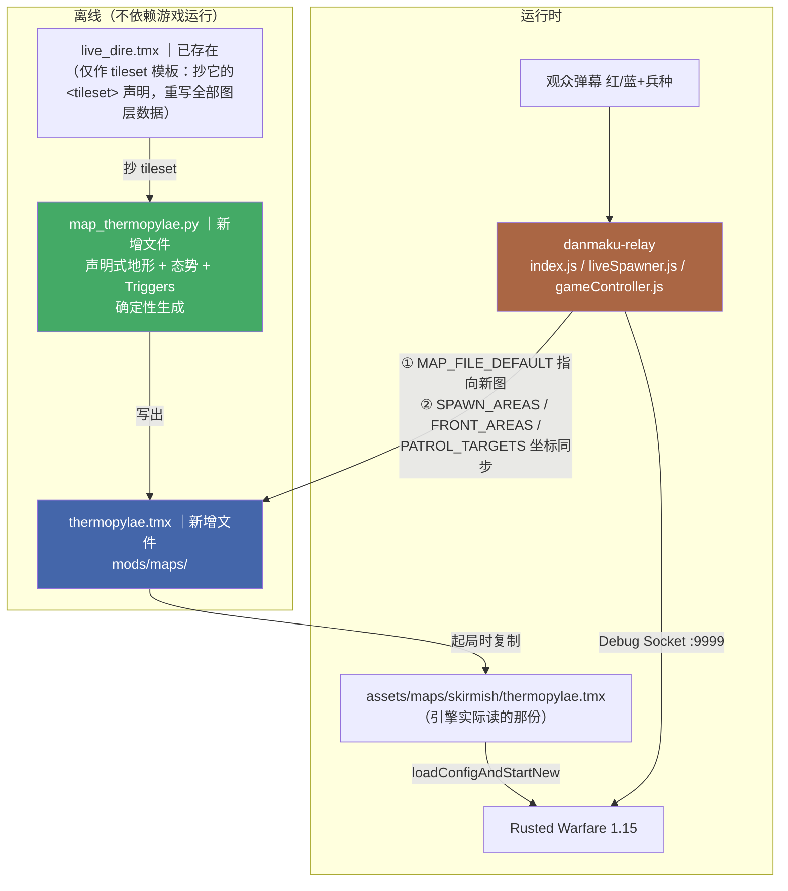

> **Model: deepseek-flash (cheap)**

> **Status: APPROVED** — 2026-09-20T16:04:06.053Z

# 温泉关战役场景（Thermopylae Scenario）实施计划

## 需求提炼

**用户原话**
- 「我说的背景是指历史背景，以及所处文明。又或者你可以调研下历史上著名的战争都有哪些，去模拟这些战争」
- 「还原战场 + 态势：地形按史实，初始兵力也按史实悬殊（守方少而精、攻方多而杂），观众弹幕去补自己拥护那方 —— 一眼看出「以少打多」」
- 「A（推荐）：隘口 + 兵力悬殊，胜负仍按拆指挥中心 —— 改动面最小，复用全部已验证链路」
- 「我只看最终结果，你继续」

**目标（一句话）**
把直播对战地图从 `live_dire.tmx` 换成**温泉关隘口场景**：地形是一条收窄到 5 格的走廊，红方（team 1）扮演数量 3.2:1 压倒的波斯攻方、蓝方（team 2）扮演扼守隘口的希腊守方；胜负规则、经济、播报、观众召唤链路**全部沿用**。

**非目标（本轮明确不做）**
- 不做攻方无基地 / 守方无经济的变体（方案 B、C）。
- 不做多战役轮换框架或战役注册表。
- 不改胜负判定、经济、播报、桌宠任何逻辑；队号 `1/2/3/4` 不变。
- 不做历史数值考据（波斯军具体人数）——只还原**结构**（多 vs 少、轻 vs 重、隘口）。

**成功判据**
1. 起一局后肉眼可辨：东端一片红色部队 vs 隘口西侧少量蓝色精锐。
2. 蓝色靠隘口宽度抵消红色数量优势。
3. 观众弹幕仍能正常召唤、扣款、播报，红蓝各归其队。
4. 一局能正常判胜负并结算。

**设计依据**：`docs/superpowers/specs/2026-09-20-thermopylae-scenario-design.md`（已提交 `8b7c502`）

---

## 现状锚点（开工前逐条核对，行号取自当前工作树）

| 锚点 | 现值 | 证据 |
|---|---|---|
| `danmaku-relay\battle\index.js:246` | `const MAP_FILE_DEFAULT = 'live_dire.tmx'` | grep 实测 |
| `danmaku-relay\battle\liveSpawner.js:234` | `const SPAWN_AREAS = {` | grep 实测 |
| `danmaku-relay\battle\liveSpawner.js:249` | `const FRONT_AREAS = {` | grep 实测 |
| `danmaku-relay\battle\liveSpawner.js:277` | `const PATROL_TARGETS = {` | grep 实测 |
| `danmaku-relay\battle\gameController.js:311` | `const ALLY_GROUP = { 0: RED_TEAM, ... }` | grep 实测 |
| `mods\maps\units.tsx` | team1=46 种、team2=10 种图块 | 逐 tile 解析实测 |
| `mods\maps\live_dire.tmx` | 110×110，Ground/Items/Units/set/Triggers 五层，tileset 40+ | 逐层解析实测 |
| `mods\maps\arena.tmx` | 引用的 `terrain/bitmaps/grass.png` **不存在** ⇒ 不可作模板 | ls 实测 |

---

## 架构



---

## 反证 / 复现（瑶光）

### 已复现的断言（可复核锚点）

| 断言 | 复现方式 | 结果 |
|---|---|---|
| team2 只有 10 种图块，"多而杂"做不到 | 逐 `<tile>` 解析 `mods\maps\units.tsx`，按 team 分桶 | team1=46 / team2=10；`assets\tilesets\units.tsx` 多出的 18 条中仅 1 条属 team2 |
| 换图必须同步改 5 处常量 | `grep -n` 命中 `index.js:246`、`liveSpawner.js:234/249/277`、`gameController.js:311` | 全部命中，行号如上表 |
| `arena.tmx` 不可作模板 | `ls mods/maps/terrain/bitmaps/grass.png` | `No such file or directory` |
| 引擎无"查询单位数量"API | 项目文档 `UNIT-COMMAND-SURFACE.md:290,424`（已扫 `Debug.java` 全表） | 确认无 |

### 待验证假设（**不作结论**，Wave 0 必须先打）

| # | 假设 | 假则后果 | 复现方式 |
|---|---|---|---|
| 1 | `Water` 图块对 `movementType: LAND` 单位不可通行 | **隘口不成立 ⇒ 本设计作废** | Wave 0 对照实验 |
| 2 | 隘口 5 格宽足以形成瓶颈 | "以少打多"不成立 | Wave 4 实机观察；假则收窄到 3 格 |
| 3 | 32:10 兵力比在 5 分钟内平衡 | 一方碾压 | Wave 4 实机跑一局后调常量 |
| 4 | 新图不触发"秒判负"回归 | 开局即结束 | 复用 `live_dire` 已验证的 Triggers 字段组合 |

> 假设 1 的间接证据：本项目 `terrain_at.py` 头注释记载"把陆地单位投进水里会静默无效（历史上已造成一次假阴性）"，且 `LAND` 与 `HOVER`（两栖）是不同 `movementType`。但**我本人未验证**，故仍列为待验证，Wave 0 先行。

---

## Wave 0：阻塞性探针 —— 水是否阻挡陆地单位

**为什么是 Wave 0**：假设 1 一旦为假，后面全部作废。必须先证。

- [ ] **0.1 对照实验**：在**现有 `live_dire.tmx`** 上打探针（不动新图）。
  - 取一个已知陆地坐标（红基地旁 `px(540,360)`）与一个已知水域坐标（地图中部水带，如 `px(1600,400)`，Wave 0 用 `terrain_at.py` 先确认该点判定为 `WATER`）。
  - 各投一辆车：`POST /api/battle/exec {"cmd":"script debug.createUnit('tank', 540, 360, 1, false)"}` 与 `... (1600, 400) ...`。
  - 等 10 秒后截图对比：陆地上的车应移动/转向，水里的车应原地不动。
- [ ] **0.2 结论落字**：把结果写进 `docs\地图设计与预设兵阵.md` 的陷阱表（无论正反）。

**验证命令**
```bash
# 先确认该点确实是水
py _archive/ccresearch-game/terrain_at.py "<GAME>/mods/maps/live_dire.tmx" 1600,400
# 起局后投兵（需中继在跑）
py -c "import urllib.request,json;print(urllib.request.urlopen(urllib.request.Request('http://127.0.0.1:8767/api/battle/exec',data=json.dumps({'cmd':\"script debug.createUnit('tank',1600,400,1,false)\",'waitMs':600}).encode(),headers={'Content-Type':'application/json'},method='POST'),timeout=30).read().decode())"
# 截图（游戏窗口不得最小化）
"C:/Users/gaven/AppData/Local/Programs/Python/Python311/python.exe" _archive/ccresearch-game/shot.py .rivet/tmp/probe_water.png "Rusted Warfare"
```
**失败分支**：若陆地单位能进水 ⇒ 停止本计划，改用"悬崖图块"方案并重做 Wave 0 验证。

---

## Wave 1：生成器 + 地图文件（只创建新文件，不覆盖任何东西）

- [ ] **1.1 写生成器** `danmaku-relay/tools/map_thermopylae.py`（**新增文件**，当前不存在）
  - 模式：`check` / `apply` / `revert --yes` / `terrain` / `dump`
  - 地形：`W=140, H=60`，陆地高度 `land_h(x)` 为分段线性纯函数（x≤40→60；40<x≤70→60→5；70<x≤78→5；78<x≤140→5→60），行区间居中，其余填水。
  - 陆地/水 gid **不硬编码**：从 `--template live_dire.tmx` 的 `<tileset>` 声明里找水 tileset（名含 `Water`）取其 gid；陆地取模板 Ground 层里最高频的非水 gid。
  - 单位与 Triggers：照 spec §4.3 / §4.4。`apply` 成功后**打印各队指挥中心 px 坐标**，供 Wave 3 抄用。
  - 确定性：`gzip.compress(..., mtime=0)`；异物/模板缺失一律 ABORT。
- [ ] **1.2 RED**：`check` 在地图不存在时报 `FAIL` 且 `exit 1`。
- [ ] **1.3 apply**：生成 `thermopylae.tmx` 到 `<GAME>/mods/maps/`（写盘前备份同名已存在文件）。
- [ ] **1.4 GREEN**：`check` → `RESULT: PASS`。

**验证命令**
```bash
py danmaku-relay/tools/map_thermopylae.py check   # 期望先 exit 1（RED）
py danmaku-relay/tools/map_thermopylae.py apply   # 生成
py danmaku-relay/tools/map_thermopylae.py check   # 期望 RESULT: PASS
py danmaku-relay/tools/map_thermopylae.py terrain # 逐格地形断言
```

---

## Wave 2：离线三重交叉验证

- [ ] **2.1 独立工具读**：`analyze_map.py <新图>` 的非空瓦片数 / 坐标 / gid 与声明一致（应为 32+10=42 个）。
- [ ] **2.2 图层字节比对**：`Ground`/`Units` 与声明一致；若沿用模板的 `Items`/`Triggers` 则逐字节一致。
- [ ] **2.3 地形连通性断言**：跑一次 BFS，证明"西端营地 → 隘口 → 东端营地"**只有一条路径**且最窄处 = 5 格（这是"隘口"的形式化定义，比肉眼看更硬）。

**验证命令**
```bash
py _archive/ccresearch-game/analyze_map.py "<GAME>/mods/maps/thermopylae.tmx"
py danmaku-relay/tools/map_thermopylae.py dump    # 打印逐层 gid 摘要供比对
```

---

## Wave 3：中继接线（**覆盖已有 JS 文件，是本计划唯一的破坏性动作**）

- [ ] **3.1** 改 `battle\index.js:246` → `'thermopylae.tmx'`
- [ ] **3.2** 改 `battle\liveSpawner.js:234/249/277` 三处坐标（值取 Wave 1.3 打印的指挥中心坐标换算）
- [ ] **3.3** `battle\gameController.js:311` `ALLY_GROUP` **确认不变**（队号未动）
- [ ] **3.4** 改完**必须重启中继**才生效（这些文件只在启动时 require）
- [ ] **3.5** 回归：`npm run verify` 必须 exit 0

> ⚠️ 本波会覆盖 3 个已有 JS 文件。执行前先 `git -C danmaku-relay status --short` 确认工作区干净、并把这些文件加入提交；改完 `npm run verify` 必须全绿。

**验证命令**
```bash
cd danmaku-relay && npm run verify      # 期望 exit 0（当前基线 203 PASS / 0 FAIL）
git -C danmaku-relay diff --stat        # 只应有 index.js / liveSpawner.js 改动
```

---

## Wave 4：实机验证（一局）

- [ ] **4.1** 重启中继（走 `relay-window.bat` 或等价环境变量；不得裸 `node index.js`，会丢经济与推手开关）
- [ ] **4.2** 起局 `POST /api/battle/start`
- [ ] **4.3** 镜头对准隘口抓图，确认"东端红军成群 vs 隘口西侧少量蓝军"
- [ ] **4.4** 发模拟弹幕 `红3战车`，确认落红方 + 扣款日志 + 播报
- [ ] **4.5** 观察一局是否正常判胜负、是否触发秒判负回归
- [ ] **4.6** 若兵力比失衡 ⇒ 调 spec §4.3 常量并重跑 Wave 1–4

**验证命令**
```bash
py _archive/ccresearch-game/wide_shot.py .rivet/tmp/thermopylae_wide.png
tail -40 danmaku-relay/logs/combined.log
grep -E "Mapfile|Disabling AI" "<GAME>/lastrun.log" | tail -5
```
**前置条件**：游戏窗口**不得最小化**（实测最小化时 `PrintWindow` 只返回 159×27，两种截图工具均失败）。若窗口最小化且未获授权还原 ⇒ 本波标注**未验证**并如实报告。

---

## 收尾

- [ ] 提交：`danmaku-relay`（生成器 + 中继改动）与根仓库（spec 已提交，补文档）
- [ ] 更新 `docs\地图设计与预设兵阵.md`：补"水阻挡"结论与温泉关场景说明
- [ ] 清理 `.rivet\tmp\` 下本次全部临时文件
- [ ] 如实报告：做了什么 / 遗留什么 / 哪几项**未验证**及原因

---

## 风险与回退

| 风险 | 回退 |
|---|---|
| 新图导致开局秒判负 | 地图文件是新增的，`MAP_FILE_DEFAULT` 改回 `live_dire.tmx` + 重启中继即恢复 |
| 兵力比失衡 | 改 spec §4.3 常量，重跑 Wave 1–4（生成器确定性，可反复重建） |
| 中继改动引入回归 | `git -C danmaku-relay` 按文件回退；改动仅 3 个常量 |
| 假设 1 为假 | 停止，改悬崖方案，本计划作废重做 |
