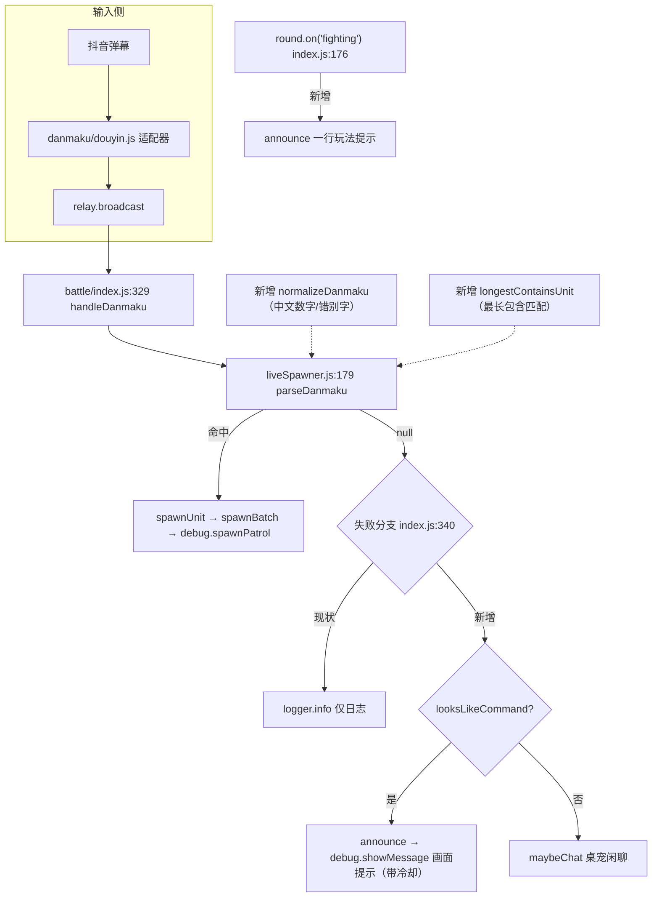

# 弹幕指令容错 + 失败可见化 实现计划

> **面向 AI 代理：** 逐任务实现并按波验证（原生计划执行纪律，见 `<plan-executing>` 块），或用 plan_task + team_orchestrate 编排多任务。

**目标：** 堵住复盘发现的「观众想参与、却因为指令写法不对而静默失败」这一类流失——做指令容错（中文数字 / 易错兵种词）与失败可见化（格式错给画面提示），并给每轮开局加一行极简玩法提示；其余候选由负责人勾选。

**架构：** 在解析入口前插一层纯函数归一化 `normalizeDanmaku(text)`（中文数字→阿拉伯、已知错别字→标准词），再给兵种匹配加一层「最长包含匹配」兜底；`parseDanmaku` 的返回结构与生兵链路一律不动。失败侧复用**唯一**的画面文字通道 `announce()`（`script debug.showMessage`，`index.js:84`）——把「未识别」从只写日志变成画面可见提示。全部改动落在中继侧 Node 代码，**不碰游戏二进制 / jar**。

**技术栈：** Node.js（CommonJS）、离线回归套件 `npm run verify`（每个 `tools/verify_*.js` 零副作用：不连游戏、不碰真实 9999）。

---

## 需求提炼

**目标（本计划覆盖）**

1. 观众把数量写成中文（`红三猛犸`）、兵种写成错别字（`红山站车`）时，系统能正确识别并出兵。
2. 观众把指令发成无效形式时，画面给一条可见反馈，而不是静默丢弃。
3. 每轮开局在游戏画面给一行极简玩法提示。

**非目标（本计划不做）**

- 不改游戏二进制、不重打 jar、不动 AI / 经济 / 地图 / 出生点。
- 不把「无阵营指令」当合法（`4蜘蛛` 仍不生成）——见候选池 C1。
- 不做塔防 / 模组内容（候选池 C2）。
- 不改早间 `game-lost` 崩溃链路（候选池 C3，先诊断后修）。

**证据（2026-09-22 真机日志 `danmaku-relay/logs/combined.log`）**

| 观众原话 | 系统行为 | 观众感知 |
|---|---|---|
| `红三猛犸` | `parseDanmaku` 返回 null（`三猛犸` 查不到兵种） | 发了没反应 |
| `红山站车` | null（`山站车` 查不到） | 发了没反应；桌宠补了一句「应该是战车不是站车哦」 |
| `4蜘蛛` | null（无 `红/蓝` 前缀，正则不匹配） | 发了没反应 |

当日进房 255 人次 / 独立 214 人，**非主播账号发出的红蓝指令去重只有 2 个发送者**——门槛与容错是参与率低的重要原因之一。

## 现状（代码锚点，执行者按此定位）

- `danmaku-relay/battle/liveSpawner.js:179` `parseDanmaku(content)` → `{team, viewerTeam, unitType, teamName, count}` | `null`。正则 `^(红|蓝|red|blue)(?:方)?\s*(\d*)\s*(.+)$`（`:193`）。
- `liveSpawner.js:198-206` 兵种匹配：先 `UNIT_MAP[unitInput]`，再退化到**精确**键/值匹配（`key === unitInput || val === unitInput`）。**没有包含匹配**，所以 `山战车` 这种带残渣的输入查不到。
- `liveSpawner.js:24` `UNIT_MAP`（中文/英文词 → 引擎类型名）。
- `liveSpawner.js:473` `unitDisplayName`（类型名 → 展示名）。
- `danmaku-relay/battle/index.js:329` `handleDanmaku(msg)`；`:334` 调 `parseDanmaku`；`:340-347` 失败分支**只写 logger**（`[DANMAKU] 未识别`）后 `return null`。
- `battle/index.js:84` `announce(text, tag)` → `script debug.showMessage('...')`（唯一画面文字通道；实测中文渲染正常）。
- `battle/index.js:176` `round.on('fighting', ...)`（每轮开战只跑一次，已有 `logger.info` + `waifuAnnouncer.announceRoundStart`）。
- `battle/index.js:530` `module.exports` 已导出 `round` / `spawner` / `handleDanmaku`（可作测试注入口）。
- 现有解析回归样板：`danmaku-relay/tools/verify_viewer_team.js:67,70`；测试开关 `spawner.setSendCommandForTest(fn)`（`liveSpawner.js` 已导出）。
- 回归链：`danmaku-relay/package.json` 的 `verify` 脚本（`check` + 13 个 `verify:*`）。

## 数据流图



## 反证/复现（瑶光）

**RED（当前代码，预期三条全 null）**

```bash
cd danmaku-relay && node -e "const s=require('./battle/liveSpawner'); for (const t of ['红三猛犸','红山站车','4蜘蛛']) console.log(t, '=>', JSON.stringify(s.parseDanmaku(t)))"
```

预期输出（这就是「发了没反应」的最小复现）：

```
红三猛犸 => null
红山站车 => null
4蜘蛛 => null
```

判据取 **exit code + stdout**，不取信任何提交信息。

**GREEN（Wave 1 完成后预期）**

- `红三猛犸` → `{team:1, viewerTeam:3, unitType:'mammothTank', count:3}`
- `红山站车` → `{team:1, viewerTeam:3, unitType:'tank', count:1}`
- `4蜘蛛` → 仍 `null`（无阵营，本计划不改此语义），但在 Wave 2 后画面出现格式提示。

**降级为待验证假设（不写进验收）**

- 「容错上线后参与率上升」无法在离线断言，标为待实测指标；本计划只验证「解析正确 + 提示可见」。

---

## Wave 1 — 指令容错解析

> 本波结束判据：`node tools/verify_danmaku_parse.js` 全 PASS，且 `npm run verify` 全绿。

### 任务 1.1：写失败测试（RED）

**文件：** 新建 `danmaku-relay/tools/verify_danmaku_parse.js`

**内容：** 仿 `tools/verify_viewer_team.js` 结构（`check(name, ok, detail)` + `PASS/FAIL` 汇总 + `process.exit(fail?1:0)`），`require('../battle/liveSpawner')` 后逐条断言：

| 输入 | 断言 |
|---|---|
| `红3战车` | `team===1 && viewerTeam===3 && unitType==='tank' && count===3`（回归护栏） |
| `红三猛犸` | `unitType==='mammothTank' && count===3` |
| `蓝四蜘蛛` | `team===2 && viewerTeam===4 && unitType==='experimentalSpider' && count===4` |
| `红十战车` | `unitType==='tank' && count===10` |
| `红山站车` | `unitType==='tank' && count===1` |
| `红 10 战车` | `unitType==='tank' && count===10`（回归护栏，`2026-09-19` 修过的空格场景） |
| `坦克杀手` | `=== null`（无阵营，不得误判） |
| `咋玩` | `=== null` |

**命令：** `cd danmaku-relay && node tools/verify_danmaku_parse.js`
**预期：** 至少 `红三猛犸 / 蓝四蜘蛛 / 红十战车 / 红山站车` 四条 FAIL（RED 成立），exit code = 1。
**commit：** `test: 弹幕解析容错回归（中文数字/错别字）红`

### 任务 1.2：中文数字归一化

**文件：** 修改 `danmaku-relay/battle/liveSpawner.js`

**改动描述（不贴实现，按签名与行为实现）：**

1. 在 `UNIT_MAP` 附近新增常量 `CN_DIGITS`：`{一:1,二:2,两:2,三:3,四:4,五:5,六:6,七:7,八:8,九:9}`。
2. 新增纯函数 `normalizeDanmaku(text)`，仅做**数字归一化**（本任务）：把中文数字串替换为阿拉伯数字，规则 `十`→`10`、`十X`→`1X`、`X十`→`X0`、`X十Y`→`XY`（X/Y 为 `CN_DIGITS` 中的字）；其余字符原样保留。
3. `parseDanmaku` 在 `const text = content.trim()`（`:181`）之后，改用 `normalizeDanmaku(text)` 的结果做正则匹配与兵种取名。**返回结构不变**。

**命令：** `node tools/verify_danmaku_parse.js`
**预期：** `红三猛犸 / 蓝四蜘蛛 / 红十战车` 转为 PASS；`红山站车` 仍 FAIL（留给 1.3）。
**commit：** `feat: 弹幕数量支持中文数字（红三猛犸→3）`

### 任务 1.3：易错兵种词归一化 + 最长包含匹配

**文件：** 修改 `danmaku-relay/battle/liveSpawner.js`

**改动描述：**

1. 新增常量 `UNIT_TYPO`（**只放有日志证据的项**）：`{站车:'战车'}`。注释写明「新增项必须先有真实弹幕证据，不要凭猜扩充」。
2. `normalizeDanmaku` 增加一步：对 `UNIT_TYPO` 的键做全局替换（`站车`→`战车`）。
3. 新增纯函数 `matchUnitByContains(input)`：在 `UNIT_MAP` 的所有键中，选出**被 `input` 包含且长度最长**的那个键，返回其值；无命中返回 `undefined`。
4. `parseDanmaku` 的兵种匹配（`:198-206`）在现有「精确匹配 → 键/值精确匹配」之后，**追加** `matchUnitByContains` 兜底（顺序不能变，避免精确项被包含匹配抢走）。

**理由（为什么必须「最长」）：** `UNIT_MAP` 里 `车`→tank、`战车`→tank、`坦克杀手`→tankDestroyer 同时存在；若用「第一个命中」，`坦克杀手` 会被 `坦克`→tank 抢走。最长匹配保证 `坦克杀手` 仍走 `tankDestroyer`。

**命令：** `node tools/verify_danmaku_parse.js`
**预期：** 全部 PASS，exit code = 0（GREEN）。
**回归：** `cd danmaku-relay && npm run verify` → 全绿（尤其 `verify:viewer` 的 B1/B2 精确解析不得回归）。
**commit：** `feat: 兵种词容错（错别字归一 + 最长包含匹配）`

### 任务 1.4：接入回归链

**文件：** 修改 `danmaku-relay/package.json`

**改动描述：** 在 `scripts` 增加 `"verify:parse": "node tools/verify_danmaku_parse.js"`，并把它插进 `verify` 脚本链（放在 `verify:viewer` 之后）。

**命令：** `npm run verify`
**预期：** 输出含新增的 `verify:parse` 段，整体 exit code = 0。
**commit：** `chore: verify 链接入弹幕解析回归`

---

## Wave 2 — 失败可见化（把「没反应」变成「这样发」）

> 本波结束判据：`node tools/verify_danmaku_hint.js` 全 PASS。

### 任务 2.1：`looksLikeCommand` 判定（纯函数）

**文件：** 修改 `danmaku-relay/battle/liveSpawner.js`

**改动描述：** 新增并导出纯函数 `looksLikeCommand(raw)`：当 `raw` 满足任一条件返回 `true` —— ① 含 `红/蓝/red/blue` 任一词；② 含 `UNIT_MAP` 任一中文键（用 1.3 的包含逻辑）。`咋玩` / `没听懂` / `？？？` 必须返回 `false`。

**命令：** `cd danmaku-relay && node -e "const s=require('./battle/liveSpawner'); console.log(s.looksLikeCommand('4蜘蛛'), s.looksLikeCommand('红'), s.looksLikeCommand('咋玩'), s.looksLikeCommand('没听懂'))"`
**预期：** `true true false false`
**commit：** `feat: 新增 looksLikeCommand 判定（供失败提示用）`

### 任务 2.2：失败分支接入画面提示（带冷却）

**文件：** 修改 `danmaku-relay/battle/index.js`

**改动描述：**

1. 新增模块级状态：`let _lastHintAt = 0`，常量 `HINT_COOLDOWN_MS = (() => { const v = parseInt(process.env.RW_HINT_COOLDOWN_MS, 10); return Number.isFinite(v) && v >= 0 ? v : 15000 })()`。
2. 在 `handleDanmaku` 的失败分支（`:340-347`）里，`logger.info` 之后、`maybeChat` 之前，插入：若 `spawner.looksLikeCommand(raw)` 且距 `_lastHintAt` 超过 `HINT_COOLDOWN_MS` ⇒ 调 `announce('格式不对哦：发「红3战车」= 召唤3辆战车（带红/蓝）', 'hint')`，并刷新 `_lastHintAt`。冷却按**全局**计，防止刷屏。
3. 不改该分支现有返回值（仍 `return null`）。

**理由：** 复用 `announce()`（唯一画面通道，`debug.showMessage`）；`looksLikeCommand` 保证闲聊（「咋玩」）不触发提示。

**commit：** `feat: 无效指令在游戏画面给格式提示（带冷却）`

### 任务 2.3：写提示行为测试

**文件：** 新建 `danmaku-relay/tools/verify_danmaku_hint.js`

**内容：** `require('../battle')` 与 `require('../battle/liveSpawner')`，用 `spawner.setSendCommandForTest((c)=>{sent.push(c);return true})` 收集命令，然后：

| 步骤 | 断言 |
|---|---|
| `battle.handleDanmaku({content:'4蜘蛛'})` | `sent` 中出现一条 `script debug.showMessage(` 且文本含 `红3战车` |
| 紧接着再发一条 `4蜘蛛` | `sent` 中没有**第二条** showMessage（冷却生效） |
| 发 `咋玩` | `sent` 中无新增 showMessage（闲聊不提示） |
| 发 `红3战车` | 走生兵路径（`spawnPatrol`），无 hint |

**命令：** `cd danmaku-relay && node tools/verify_danmaku_hint.js`
**预期：** 全 PASS，exit code = 0。
**commit：** `test: 无效指令画面提示 + 冷却回归`

---

## Wave 3 — 每轮开局的一行玩法提示

> 本波结束判据：离线断言模板 + 实机截图确认画面出现。

### 任务 3.1：提示话术纯函数 + 挂到 `fighting`

**文件：** 修改 `danmaku-relay/battle/index.js`

**改动描述：**

1. 新增纯函数 `ruleHintText()`，返回固定串 `发「红3战车」= 召唤3辆战车替你支持的阵营打仗`（与 `waifuAnnouncer.RULES_TEXT` 区分：后者是**语音长文**，此处只求画面一行、短）。
2. 在 `round.on('fighting', ...)`（`:176`）内、`waifuAnnouncer.announceRoundStart(r)` 之后，追加 `announce(ruleHintText(), 'rule')`。

**命令（离线断言模板）：** `cd danmaku-relay && node -e "const b=require('./battle'); b.round.emit('fighting',{round:1}); console.log('emitted')"`
**预期：** 命令 `announce` 通过 `debug.showMessage` 发出（在 relay 日志出现 `[BATTLE][播报][rule]`）；进程不因定时器挂住（看门狗/推手计时器均为 `unref`）。
**实机验证：** 起一局，截图游戏窗口 → 画面出现该行文字（用 `PrintWindow` 抓图后肉眼确认，与 2026-09-19 验证 `showMessage` 的方法一致）。
**commit：** `feat: 每轮开局在画面提示一行玩法`

---

## 候选池（本计划未纳入，请负责人逐项勾选）

| 编号 | 内容 | 依据 | 我的建议 |
|---|---|---|---|
| C1 | 无阵营指令（`4蜘蛛`）默认归到该观众的归属队 | 日志有 `4蜘蛛` 失败 | **暂不做**：会改现有「无前缀=不生成」语义，且闲聊可能误触发生兵；要做需先定义「归属缺失时怎么办」 |
| C2 | 塔防增强 / 模组升级 | 观众原话「什么时候才能增强塔防？」「升级模组更好玩。」 | **另立项目**：属内容/产品方向，不是互动链路工单 |
| C3 | 早间 `game-lost` 崩溃根因诊断 | 07:00 前 JVM 连起 5 个、整轮 game-lost | **建议做诊断（不直接修）**：先读 `lastrun.log` + `hs_err`，定位是显卡/资源/注入三选一 |
| C4 | 进一步降低参与门槛（随便发言即随机发兵） | 214 人仅 2 人发指令 | **不建议**：会稀释「指令=参与」的仪式感，且与 C1 同属语义变更 |
| C5 | 长局僵局（3600s 超时轮）治理 | 当日多轮 `timeout` 3600s | **已缓解**：`roundMaxMs` 已由 3600000 调为 120000（在 `data/battle-config.json`）；本计划不再动 |

---

## 收尾自检

1. **规格覆盖：** 三条目标 → Wave 1（目标 1）/ Wave 2（目标 2）/ Wave 3（目标 3）；非目标与候选池逐条有归属。
2. **占位符扫描：** 无 `TODO/TBD/待定/后续实现`；`UNIT_TYPO` 仅含证据项 `站车→战车`，扩展规则已写明「先有日志证据」。
3. **类型一致性：** 新增名 `normalizeDanmaku` / `matchUnitByContains` / `looksLikeCommand` / `ruleHintText` / `CN_DIGITS` / `UNIT_TYPO` / `HINT_COOLDOWN_MS` 在各任务中一致；`parseDanmaku` 返回结构跨任务不变；测试文件路径与 `package.json` 引用一致。

## 风险与回滚

- **最长包含匹配可能误判**（如某词恰好含另一兵种名）：任务 1.3 用「精确优先、包含兜底」的顺序 + `verify_viewer_team.js` 的精确用例做护栏；若出现误判，回滚点就是 1.3 单任务。
- **提示刷屏**：任务 2.2 用全局冷却（默认 15s，`RW_HINT_COOLDOWN_MS` 可调、`=0` 关闭）。
- 全部改动可独立回滚（每个任务一个 commit），不涉及二进制 / 游戏文件。
