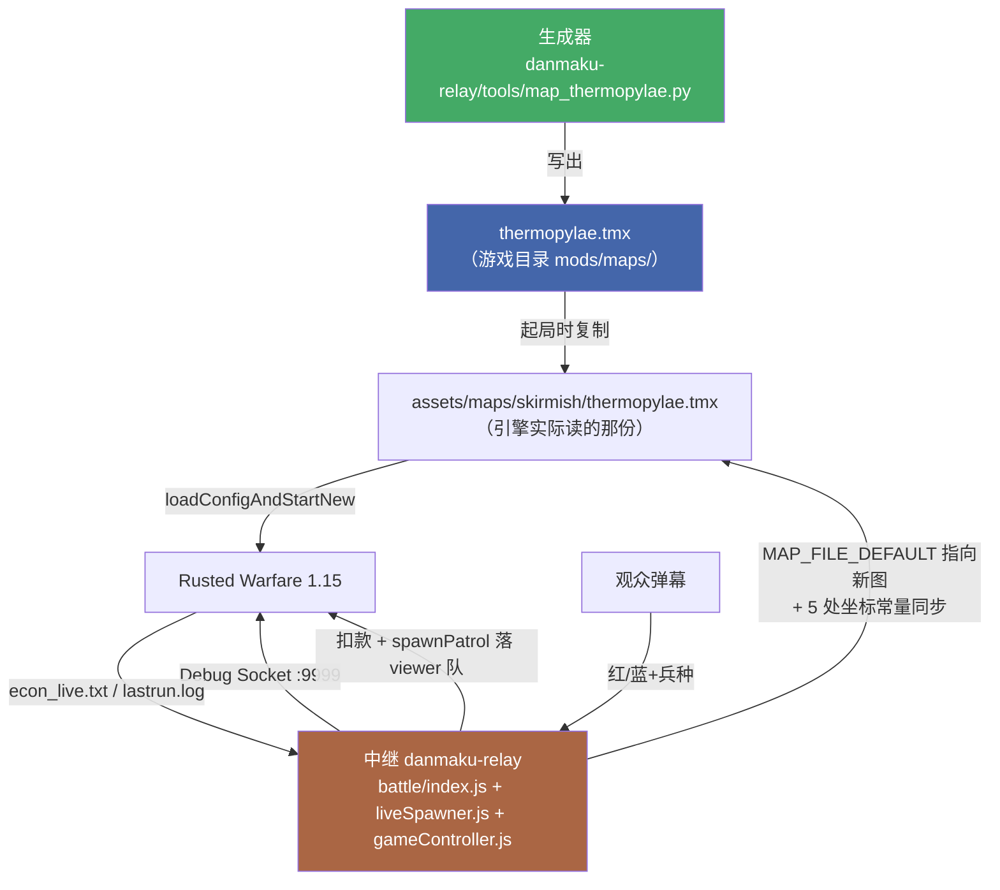

# 温泉关战役场景（Thermopylae Scenario）设计稿

> 状态：设计已获用户口头批准（"都可以"），本文档为其正式落字版
> 日期：2026-09-20
> 适用项目：live-waifu 弹幕对战直播

---

## 一、需求提炼

### 目标（用户原话级）

> "我说的背景是指历史背景，以及所处文明。又或者你可以调研下历史上著名的战争都有哪些，去模拟这些战争"

> "还原战场 + 态势：地形按史实，初始兵力也按史实悬殊（守方少而精、攻方多而杂），观众弹幕去补自己拥护那方 —— 一眼看出「以少打多」"

> "A（推荐）：隘口 + 兵力悬殊，胜负仍按拆指挥中心 —— 改动面最小，复用全部已验证链路"

**落地为一句话**：把铁锈战争的直播对战地图换成**温泉关战役的场景**——地形做成一条隘口走廊，红方扮演数量压倒的波斯攻方、蓝方扮演扼守隘口的希腊守方，观众发弹幕补自己拥护那方；胜负规则完全沿用现有链路（拆指挥中心）。

### 非目标（明确排除）

- **不做**"攻方无基地"的纯攻防（方案 B 的经济不对称）——本轮不做。
- **不做**攻方分波涌入（方案 C）——本轮不做。
- **不做**多战役轮换框架——本轮只做温泉关一场；生成器的代码结构需便于日后加新战役，但不预先搭注册表。
- **不改**胜负判定链路、经济链路、播报链路、桌宠链路——全部复用。
- **不改**红蓝队号（`RED_TEAM=1` / `BLUE_TEAM=2` / 观众宿主队 3、4）。

### 成功判据

1. 起一局后，**一眼能看出**东端有一条数量压倒的红色部队、隘口西侧只有少量蓝色精锐。
2. 蓝色靠隘口宽度抵消红色数量优势——即"以少打多"在地形上成立。
3. 观众弹幕仍能正常召唤单位、扣钱、播报；红蓝双方的兵分别落到各自阵营。
4. 一局能正常判胜负并按现有机制结算。

---

## 二、背景与证据（为什么这么设计）

以下都是本项目**实测或逐行核验**过的事实，不是推测：

### 2.1 引擎能表达什么、不能表达什么

| 能力 | 证据 |
|---|---|
| 地形层自由绘制 | `mods\maps\` 下存在自制图 `arena.tmx` / `battle_arena.tmx` / `live_battle.tmx` |
| 单位按 `(队伍, 兵种)` 预设在地图上 | `units.tsx` 每个 `<tile>` 带 `team` + `unit` 两个属性；`gid = firstgid + tile_id`（本项目实测） |
| 队伍/胜负/镜头/事件 | `Triggers` 层的 `map_info` / `team_N_info` / `camera_start`（反编译 `gameFramework\n\f.java:272/277/362-369` 逐行核对） |
| **没有**查询单位数量的脚本 API | 项目文档 `UNIT-COMMAND-SURFACE.md:290,424` 已扫 `Debug.java` 全表确认 |
| **没有**士气/补给/天气/多阶段时间线 | 引擎无此类概念 |

### 2.2 图块（tileset）对队伍的限制——本设计的关键约束

`mods\maps\units.tsx`（261 图块，`md5 a839fbfb…`）的 `(team, unit)` 分布：

| 队伍 | 可选单位数 | 内容 |
|---|---|---|
| team 1 | **46** | 全套：`tank`/`heavyTank`/`hoverTank`/`artillery`/`mammothTank`/`laserTank`/`helicopter`/`battleShip`/… |
| team 2 | **10** | 仅 `builder`/`tank`/`heavyTank`/`heavyHoverTank`/`commandCenter`/`turret`/`antiAirTurret`/`landFactory`/`airFactory`/`extractor` |
| team 3 | 9 | 无 `tank` |
| team 4 | 7 | 仅虫族 |

另核对 `assets\tilesets\units.tsx`（279 图块）：多出的 18 个条目里**只有 1 个属于 team2**（`experimentalSpider`）。**结论：team2 无法"多而杂"**。

→ **这直接决定了角色分配**（见 §4.1）。

### 2.3 隘口的技术实现路径

- `arena.tmx` 曾尝试用两个内联 tileset（`Grass` gid 1 / `Water` gid 2）做最小图，但它引用的 `mods\maps\terrain\bitmaps\grass.png` **不存在**（实测），说明该模板不可靠。
- 因此改走**更稳路线**：新图**复制 `live_dire.tmx` 的 tileset 声明**（40+ 个引用均已在生产验证可用），只**重写全部图层数据**。
- 陆地/水用的具体 gid 由生成器**从 tileset 定义反推**（复用 `_archive\ccresearch-game\terrain_at.py` 已有的水 tileset 判定逻辑），不硬编码。

### 2.4 中继与地图的绑定（换图的代价）

`danmaku-relay` 有 5 处与地图绑死的常量，换图必须同步：

| 位置 | 内容 |
|---|---|
| `battle\index.js:246` | `MAP_FILE_DEFAULT = 'live_dire.tmx'` |
| `battle\liveSpawner.js:234` | `SPAWN_AREAS`（红/蓝基地旁空投区） |
| `battle\liveSpawner.js:249` | `FRONT_AREAS`（前压交火区） |
| `battle\liveSpawner.js:277` | `PATROL_TARGETS`（巡逻目标=敌方基地） |
| `battle\gameController.js:311` | `ALLY_GROUP`（队号→同盟组） |

---

## 三、系统架构



**组件边界**：

- **生成器**（新增，纯离线）：输入一份地形与态势的**声明式描述**，输出确定性的 `.tmx`。不联网、不依赖游戏运行。
- **地图文件**（新增）：只描述静态世界——地形、初始单位、队伍与胜负规则、开局镜头。
- **中继**（改造 5 处常量）：运行时行为不变，只是指向新图的坐标。

---

## 四、设计细节

### 4.1 角色分配：红=波斯攻方，蓝=希腊守方

| | 队伍 | 历史角色 | 为什么 |
|---|---|---|---|
| 攻方（多） | **红 / team 1** | 波斯 | team1 有 46 种图块 → 能做"多而杂" |
| 守方（精） | **蓝 / team 2** | 希腊 | team2 只有 10 种 → 恰好够"少而精"（`heavyTank` + `heavyHoverTank` + `turret` + `antiAirTurret`） |

两者**恰好互补**，且零 tileset 新增风险。

> 备选（**不在本轮范围**，列为待验证增强）：给 `units.tsx` 追加 team2 的 `<tile>` 条目。关键假设是"引擎只读 tile 的 `properties`、tileset 图片仅是 Tiled 图标"，**未经验证**，需先打探针。

### 4.2 地图与地形

| 项 | 值 |
|---|---|
| 文件名 | `thermopylae.tmx` |
| 尺寸 | **140 × 60 tiles**（tile 20px → 2800 × 1200 px） |
| 图层 | `Ground` / `Items` / `Units` / `Triggers`（与 `live_dire` 同构；`set` 层可省） |
| tileset | **复制 `live_dire.tmx` 的全部 `<tileset>` 声明**（已验证可用） |

地形剖面（x 轴向东）：

```
x:  0        40            70   78        140
    |---------|-------------|----|----------|
    | 希腊营地 |   缓冲地带   |隘口|  波斯集结区 |
    | (宽60格) |  (渐收窄)    | 5格|  (渐展开)  |
```

- 西端 x∈[0,40]：整幅 60 格高均为陆地（守方营地）。
- x∈[40,70]：两侧开始被水侵入，陆地高度从 60 格线性收窄到 5 格。
- x∈[70,78]：**隘口**，陆地仅 5 格高（居中）。
- x∈[78,140]：陆地高度从 5 格线性展开回 60 格（攻方集结区）。

生成规则是**确定性纯函数**（无随机数），故 `gzip(mtime=0)` 后可逐字节复现。

### 4.3 初始态势

坐标单位：tile。

| 队伍 | 单位 | 数量 | 位置 |
|---|---|---|---|
| **红（波斯）** | `commandCenter` ×1 | 1 | x≈134, y=30 |
| | `builder` ×1 | 1 | x≈132, y=30 |
| | `tank` | 20 | x∈[100,130]，分 4 列梯形排布于通道内 |
| | `heavyTank` | 6 | x∈[108,124]，混编在 `tank` 之间 |
| | `hoverTank` | 2 | x≈96, y=30 两侧 |
| | `artillery` | 2 | x≈126，最后排 |
| **蓝（希腊）** | `commandCenter` ×1 | 1 | x≈5, y=30 |
| | `builder` ×1 | 1 | x≈7, y=30 |
| | `heavyTank` | 3 | 隘口西侧 x≈68，y=29/30/31 |
| | `heavyHoverTank` | 2 | x≈66，y=29/31 |
| | `turret` | 2 | x≈70，y=28/32 |
| | `antiAirTurret` | 1 | x≈64, y=30 |

合计：红 **32**、蓝 **10**。兵力比 3.2 : 1 —— "一眼看出以少打多"。

> 注：`commandCenter` 与 `builder` 是引擎要求的最小配置（`winCondition=commandCenter` 需要一个可被拆的目标；`builder` 保证 AI 能自行运转），**不是史实对应物**。

### 4.4 `Triggers` 配置

```xml
<objectgroup name="Triggers">
  <!-- 地图规则 -->
  <object name="map_info">
    <property name="type" value="skirmish"/>       <!-- 对战模式 -->
    <property name="winCondition" value="commandCenter"/>  <!-- 拆指挥中心判负 -->
    <property name="fog" value="map"/>             <!-- 沿用现网生产配置 -->
    <property name="introText" value="温泉关 480 BC · 波斯大军压境 · 希腊守军扼守隘口"/>
  </object>

  <!-- 红=波斯：资金高于蓝，体现"大军"体量 -->
  <object name="team_1_info" type="team_info">
    <property name="team" value="1"/>
    <property name="credits" value="99999"/>
    <property name="allyGroup" value="1"/>
  </object>

  <!-- 蓝=希腊 -->
  <object name="team_2_info" type="team_info">
    <property name="team" value="2"/>
    <property name="credits" value="99999"/>
    <property name="allyGroup" value="2"/>
  </object>

  <!-- 观众召唤兵的无 AI 宿主席位（机制与现网完全一致，仅坐标随新图调整） -->
  <object name="team_3_info" type="team_info">
    <property name="team" value="3"/><property name="allyGroup" value="1"/><property name="disabledAI" value="1"/>
  </object>
  <object name="team_4_info" type="team_info">
    <property name="team" value="4"/><property name="allyGroup" value="2"/><property name="disabledAI" value="1"/>
  </object>

  <!-- 开局镜头：对准隘口（x∈[70,78] tiles → px[1400,1560]，中心 1480） -->
  <object name="camera_start" x="1480" y="600">
    <property name="zoomTo" value="1"/>
  </object>
</objectgroup>
```

> `winCondition=commandCenter` 不可省——项目实测：缺了它会回落到"以本地 team 0 为参照"的默认判定，导致一进游戏就弹 Defeat 面板。

### 4.5 中继改造（5 处常量）

| 文件:行 | 现值 | 新值 |
|---|---|---|
| `battle\index.js:246` | `'live_dire.tmx'` | `'thermopylae.tmx'` |
| `battle\liveSpawner.js:234` `SPAWN_AREAS` | 红 (515–565, 335–385) / 蓝 (1675–1725, 1675–1725) | 红：东端营地旁 ≈ (2560–2640, 560–640)；蓝：西端营地旁 ≈ (100–180, 560–640) |
| `battle\liveSpawner.js:249` `FRONT_AREAS` | 红/蓝各一块 | 红：隘口东侧 ≈ (1560–1640, 560–640)；蓝：隘口西侧 ≈ (1360–1440, 560–640) |
| `battle\liveSpawner.js:277` `PATROL_TARGETS` | 红→(1716,1652) / 蓝→(560,380) | 红→蓝指挥中心 ≈ (110,610)；蓝→红指挥中心 ≈ (2690,610) |
| `battle\gameController.js:311` `ALLY_GROUP` | 3→红 / 4→蓝 | **不变** |

坐标以生成器输出的实际单位位置为准（生成器 `apply` 后打印各队指挥中心 px 坐标，中继照抄）。

### 4.6 生成器工具

新增 `danmaku-relay/tools/map_thermopylae.py`（放在 relay 仓库内，理由：`_reports\` 与 `_archive\` 都在 `.git\info\exclude` 里、不受版本管理，历史上因此丢过东西）。

三个模式：

| 命令 | 行为 |
|---|---|
| `check` | 校验目标地图是否符合设计（尺寸/图层/每格地形/每个单位/Triggers 字段），任一不符 → `exit 1` |
| `apply` | 确定性重建地图；已是最新则报"无变化"；目标文件有任何**非本工具写入**的痕迹则 ABORT |
| `revert` | 删除由本工具生成的 `thermopylae.tmx`（写盘前先打印将删除的路径与大小，需带 `--yes` 才真正执行） |

生成器还会在 `apply` / `check` 成功后**打印各队指挥中心的 px 坐标**，供 §4.5 的中继常量直接抄用——避免手工换算 tile→px 出错。

确定性要求：`gzip.compress(..., mtime=0)`；同一声明必产出同一字节序列。

---

## 五、验证方案

### 5.1 开工前：打一个 30 秒探针（阻塞后续所有工作）

**要验证的假设**：`Water` 图块对 `movementType: LAND` 的单位确实不可通行。

**方法**：用生成器产出地图后，实机起一局，把红方一个 `tank` 用 `debug.spawnPatrol` 投到水域一侧让其穿越；观察 `lastrun.log` 与画面。

**若假设不成立**（陆地单位能走进水里）⇒ 隘口不成立，**必须停下来**改用"悬崖"图块方案并重新验证，本设计作废重来。

### 5.2 离线验证（三重，互相独立）

1. **生成器自检**：`map_thermopylae.py check` → `RESULT: PASS`（含逐格地形断言与逐单位断言）。
2. **独立工具交叉读**：`_archive\ccresearch-game\analyze_map.py <新图>` 读出的非空瓦片数、坐标、gid 与设计一致。
3. **字节级比对**：非 `Units`、非 `Ground` 的图层与模板逐字节一致；`Ground`/`Units` 的 gid 序列与声明一致。

### 5.3 实机验证（一局）

起一局，`debug.setZoom` + `debug.lookAt` 对准隘口抓图，确认：

- 东端有大批红色单位、隘口西侧少量蓝色单位（数量对比肉眼可辨）。
- 镜头/雾/胜负面板正常（不弹 Defeat）。
- 发一条模拟弹幕 `红3战车`，单位落到红方、扣款日志正常。

> **前置条件**：游戏窗口不得处于最小化状态（本项目实测：最小化时 `PrintWindow` 只返回 159×27，两种截图工具均失败）。若窗口最小化且用户未授权还原，则本项标注为**未验证**。

---

## 六、未验证假设与风险

| # | 假设 | 若为假的后果 | 处理 |
|---|---|---|---|
| 1 | `Water` 图块对 LAND 单位不可通行 | 隘口不成立，整个设计作废 | §5.1 探针先行；假则停下来重设计 |
| 2 | 隘口 5 格宽足以形成瓶颈（而非被 20 辆坦克挤过去） | "以少打多"不成立 | 实机观察；假则收窄到 3 格 |
| 3 | 32 : 10 的兵力比在 5 分钟内平衡 | 要么红方碾压、要么蓝方反推过快 | 实机跑一局后调 `LAYOUT` 常量 |
| 4 | `units.tsx` 的 `properties` 与图片无关 | 影响 §4.1 的"备选增强"，不影响本轮 | 不在本轮范围 |
| 5 | 新图不会触发历史上"开局 10 秒判失联/秒判负"回归 | 开局即结束 | 复用 `live_dire` 已验证的 Triggers 字段组合（仅改坐标与文案） |

---

## 七、YAGNI：明确不做的事

- 不搭"战役注册表"或战役轮换框架（只有一场）。
- 不做地形绘制 GUI / Tiled 集成（声明式配置足够）。
- 不做历史准确性的数值考据（如波斯军具体人数）——只做**结构**还原（多 vs 少、轻 vs 重、隘口）。
- 不改任何现有 JS 逻辑，只改 5 个常量值。
