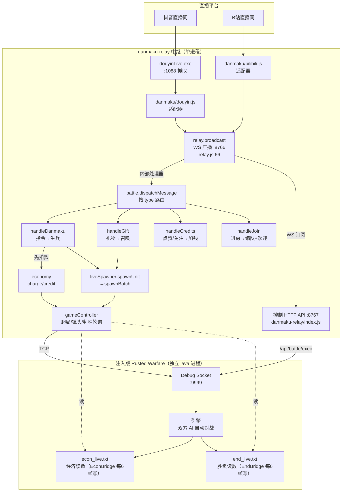
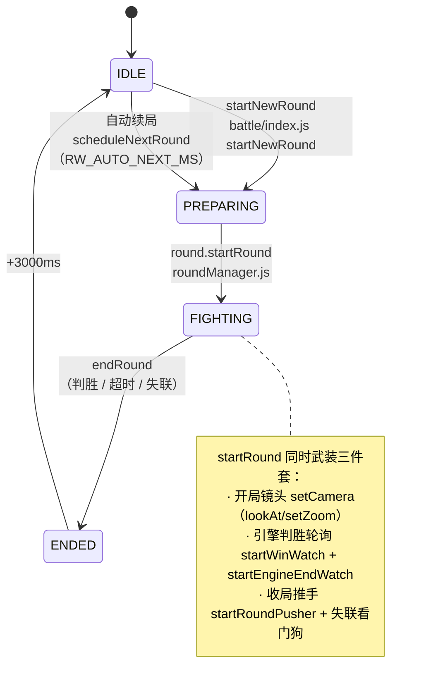
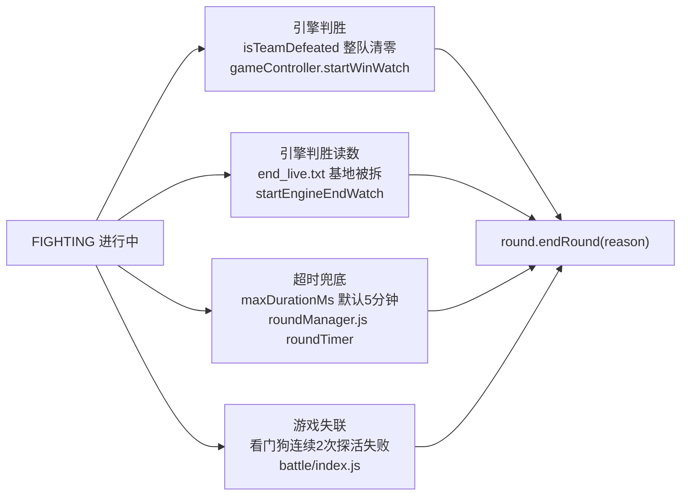
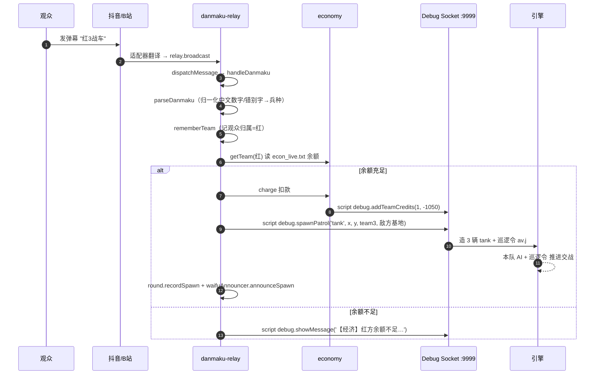
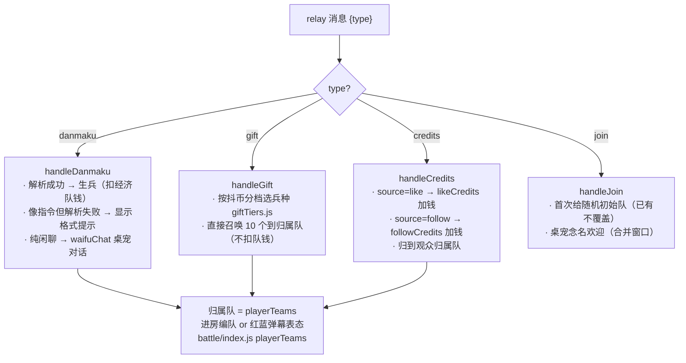

# 红蓝对战直播 · 机制与运作流程

> 本文用 Mermaid 描述**当前线上主力**（danmaku-relay + 注入版 Rusted Warfare）的完整机制。
> 所有节点均锚定源码 `文件:行号`，2026 取证。
> （war-danmaku 是另一条独立的纯 Web Canvas 自研线，不在本图内。）

---

## 一、全景系统架构与数据流

**队伍模型**（`battle/teams.js`）：红=`team 1`、蓝=`team 2`（有 AI，自动进攻）；观众召唤的兵落到**无 AI 宿主队** 红=`team 3` / 蓝=`team 4`（`team_3/4_info` 的 `disabledAI` 保证本队 AI 不接管，兵只认脚本巡逻令）；`team 0` = 本地人类观战槽（不放单位 ⇒ 全图观战视角）。

---

## 二、单局生命周期状态机

**FIGHTING 阶段的四条结束路径**（谁先命中谁结束）：

---

## 三、一条弹幕的端到端时序

---

## 四、观众互动事件 → 处理（`battle/index.js`）

> ⚠️ `playerTeams` **只驻内存**，中继重启即丢失（`battle/index.js` 注释）。

---

## 五、反馈与"被看见"通道（现状）

| 通道 | 实现 | 锚点 |
|---|---|---|
| 游戏画面文字 | `script debug.showMessage`（中文已实测） | `battle/index.js:84` announce() |
| 桌宠语音 TTS | waifuBridge.speak，含生兵合并窗口 | `waifuAnnouncer.js` |
| 桌宠对话 | LLM（默川人格），非指令弹幕触发 | `waifuChat.js` |
| 镜头 | `debug.lookAt` / `debug.setZoom`（开局一次性） | `gameController.js:706` setCamera |
| 经济显示 | 引擎右上角原生 `$余额(+收入)` | `econ_live.txt` |

**缺口**（对应设计讨论）：礼物召唤**无冠名/无播报**、无个人功勋/军衔、镜头不跟随——即"投了兵看不见、花了钱没名字"。

---

## 六、关键锚点索引

| 环节 | 文件:行 |
|---|---|
| 顶层入口 / API | `danmaku-relay/index.js` main / handleAPI |
| 广播总线 | `danmaku-relay/relay.js:66` broadcast |
| 消息路由 | `danmaku-relay/battle/index.js` dispatchMessage |
| 弹幕解析 | `danmaku-relay/battle/liveSpawner.js` parseDanmaku |
| 生兵 | `liveSpawner.js` spawnUnit → spawnBatch |
| 经济 | `battle/economy.js` charge / credit / getTeam |
| 轮次状态机 | `battle/roundManager.js` RoundManager |
| 队伍模型 | `battle/teams.js` RED/BLUE/VIEWER_TEAM |
| 起局/镜头/判胜 | `battle/gameController.js` startGame/loadMap/setCamera/startWinWatch |
| 礼物档 | `battle/giftTiers.js` GIFT_TIERS |
| 玩法配置 | `battle/battleConfig.js` LIMITS |

---

## 七、2026-09-27 变更：观众独立钱包 + 荣誉奖励

**分账（观众独立钱包）**：观众的钱从 AI 主队（`team1/2`，AI 自己的钱也在此）搬到**观众宿主队**（红=`team3` / 蓝=`team4`；`econ_live.txt` 里各带 4000 底金、收入 0）。点赞/关注充值、弹幕召唤扣款都落 viewer 队 ⇒ **AI 花不到观众的钱**，战局更可解释。开关 `battleConfig.walletMode`（`viewer` 默认 / `shared` 回退旧行为）。锚点：`battle/liveSpawner.js:spawnUnit`（econTeam）、`battle/index.js:handleCredits`（walletTeam）、`battle/teams.js:viewerTeamOf`。

**互动质量**：关注**按时间窗去重**（`followWindowMin`，默认 **60 分钟**；窗口内重复关注**既不发奖也不播报**——防刷桌宠语音；超过窗口算新的一次，"取关再关注"能再拿；`0` = 只算第一次；`RW_FOLLOW_WINDOW_MS` 覆盖）；点赞**按连赞数量化**（`likeCredits + (连赞数-1)×likePerExtra`，单次封顶 `likeCap`），且**播报每观众每轮一次**（`RW_LIKE_CHAT_ONCE`）。

**双榜**：`battle/leaderboard.js` 维护两套 —— **本轮榜**（每轮 `fighting` 清零，供本轮战报/冠军判定）与 **累计榜**（跨轮、落盘 `data/leaderboard-season.json`，含 **`wins` 夺冠次数**，排序 `wins→spawns→spent`）。经 `GET /api/leaderboard` 同时暴露（`viewers` + `season`），OBS 页 `toolbox/leaderboard.html` 两张表并排渲染；`POST /api/leaderboard/reset-season` 开新赛季。

**结算露出**：`round.on('ended')` 除胜负外用 `announce()` 追加「贡献榜前三」；桌宠 TTS 同步（`waifuAnnouncer.roundEndText` 的 `top3`）。

**荣誉（纯展示，不加战力）**：上一轮前三 → 下一轮代表单位头顶带【冠军/亚军/季军】前缀（`repLabelText`）+ 冠军贴 `toolbox/badge_champion.png` 徽章；OBS 榜单（`toolbox/leaderboard.html`）前三行金银铜高亮。开关 `RW_CHAMPION_AWARD` / `RW_CHAMPION_BADGE`。

**阵营配额**：每队每轮观众兵总量上限 `summon.teamCapPerRound`（默认 300，`RW_TEAM_CAP_PER_ROUND` 可覆盖），防分账后一方兵海。

**开局余额**：AI 主队(team1/2) 用 `startingCredits`、**观众钱包**(team3/4) 用 `viewerStartingCredits`（默认 **100000**），都在控制面板「开局配置」可调、每轮开局重设（`0 = 不改`，观众队默认仅 4000）。锚点：`battle/gameController.js` 起局段（`setTeamCredits(RED/BLUE_VIEWER_TEAM, …)`）、`battle/battleConfig.js` LIMITS。
